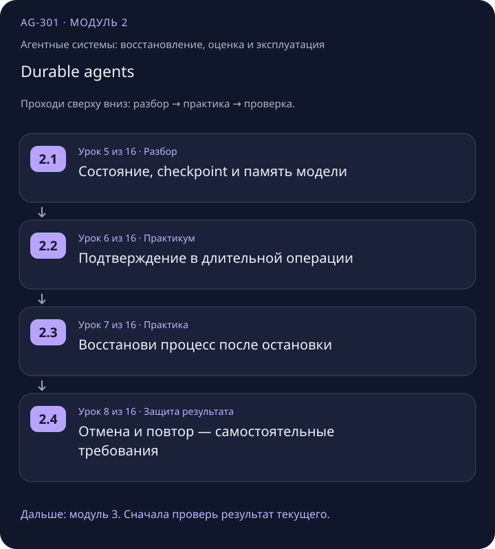
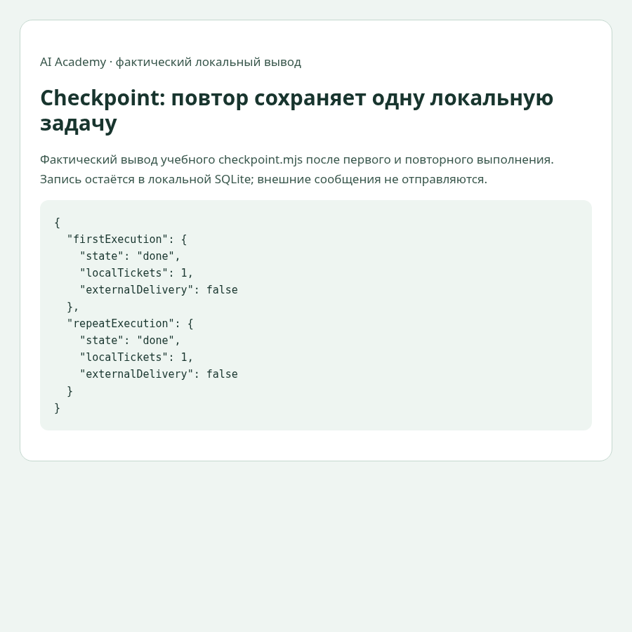
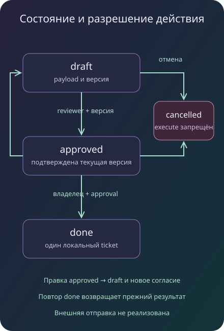
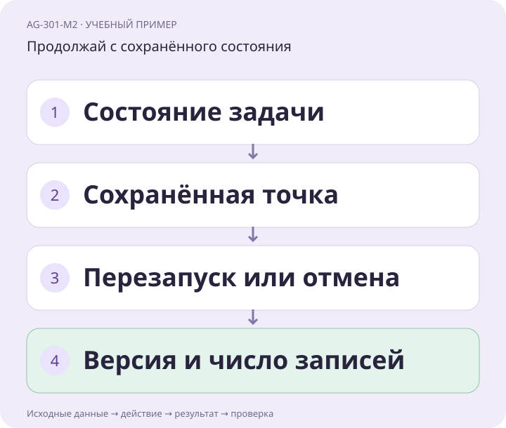

# Модуль 2 из 4 · Durable agents

[← Агентные системы: восстановление, оценка и эксплуатация · весь порядок уроков](README.md)

Уроки 5–8 из 16. Проходи их сверху вниз: от 2.1 к 2.4, затем к следующему модулю.

Тексты и практика для просмотра. Зачёт, квизы и прогресс выполняются в мини-аппке после публикации материалов.

## В этом модуле

1. [Урок 5 · 2.1 · Состояние, checkpoint и память модели](#lesson-ag-301-m2-l1)
2. [Урок 6 · 2.2 · Подтверждение в длительной операции](#lesson-ag-301-m2-l2)
3. [Урок 7 · 2.3 · Восстанови процесс после остановки](#lesson-ag-301-m2-l3)
4. [Урок 8 · 2.4 · Отмена и повтор — самостоятельные требования](#lesson-ag-301-m2-l4)

## Урок 5 из 16 · 2.1 · Состояние, checkpoint и память модели

Код занятия: `AG-301-M2-L1`.

[← Предыдущий урок: Урок 4 · 1.4 · Архитектурное ревью workflow](M1.md#lesson-ag-301-m1-l4)

[Следующий урок →: Урок 6 · 2.2 · Подтверждение в длительной операции](M2.md#lesson-ag-301-m2-l2)

Браузерный просмотр реального вывода checkpoint.mjs из временной SQLite. Повтор проверен, внешние действия и сообщения отсутствуют.

Checkpoint сохраняет достаточно состояния, чтобы понять, что можно делать после остановки. Он не обязан сохранять весь разговор. Для действия важны владелец, payload, версия, подтверждение и итог. Для восстановления недостаточно одной фразы «план выполнен» без связи с результатами шагов.

TaskStore хранит эти поля в SQLite. Команда checkpoint.mjs prepare создаёт задачу и имитирует учебного reviewer, execute создаёт локальный ticket. Между командами процесс можно остановить, а состояние прочитать из того же файла. Это сохранность локальной модели, не восстановление распределённого кластера.

Раздели память разговора, рабочее состояние задачи и журнал аудита. У них разные назначения и сроки хранения. Восстановленный процесс не должен брать из старой беседы новое разрешение на изменившийся payload. Сдай схему данных и повтор запуска на отдельной тестовой базе. Укажи, какие сведения нужны для безопасного продолжения и какие можно не хранить вовсе, чтобы уменьшить объём чувствительных данных.

### Практика

Результат: Схема checkpoint и проверка перезапуска. Для одного сценария запиши границу доверия, версию данных, ожидаемое состояние и правило остановки. Выполни проверку на отдельной учебной базе. В отчёте раздели выполненные действия, имитации и спроектированные компоненты.

### Самопроверка

- Память разговора отделена от состояния
- Разрешение связано с актуальным payload
- Предел локальной сохранности указан

### Подсказка

Если поведение непонятно, проследи источник, текущую версию задачи и основание разрешения. Не пытайся исправить проблему полномочий более убедительной формулировкой модели.

[Скачать лабораторию помощника](https://github.com/ilyasazelkhanov-hash/elaz-ed/raw/refs/heads/main/public/learning/academy/assistant-lab.zip). На Node 24 выполни `node --test retrieval.test.mjs tasks.test.mjs evaluation.test.mjs` и `node evaluate.mjs`. Для checkpoint используй `node checkpoint.mjs prepare ./teaching.sqlite`, затем `execute` с тем же файлом. Reviewer в этой команде имитируется, внешней отправки нет.

## На примере: Продолжай с сохранённого состояния

Checkpoint — сохранённая точка выполнения, по которой можно продолжить процесс после остановки. Память модели или открытая вкладка не заменяют запись состояния и подтверждения выполненных действий.

Локальная учебная задача прерывается после подготовки, но до исполнения разрешённой записи.

### Что есть в начале

Задача T-61, версия входа 1, сохранённый шаг и подтверждение конкретного изменения. Работа выполняется на отдельной учебной базе.

### Разберём по шагам

1. Запиши, какие поля нужны для продолжения: шаг, версия входа, параметры действия и основание разрешения.
2. Останови и перезапусти локальный процесс, затем сопоставь восстановленное состояние с сохранённым.
3. Проверь отмену и повтор: отменённая задача не исполняется, неизменённый повтор не создаёт второй локальный объект.

### Что должно получиться

В журнале различаются подготовка, ожидание подтверждения, исполнение и отмена; восстановление не означает повтор всего пути.

### Где легко ошибиться

Продолжить с другим входом по старому разрешению или назвать перезапуск вкладки сохранностью базы.

### Проверка примера

Сверь версии и число результатов до и после повтора. Ограничение долговечности локального стенда укажи явно.

Это вымышленный учебный пример. Он не подтверждает выполненное внедрение, AI-вызов или независимое ревью. Свою практику выполни отдельно.

### Результат занятия

Схема checkpoint и проверка перезапуска

### Критерии

- Память разговора отделена от состояния
- Разрешение связано с актуальным payload
- Предел локальной сохранности указан

### Куда дальше

[← Предыдущий урок: Урок 4 · 1.4 · Архитектурное ревью workflow](M1.md#lesson-ag-301-m1-l4)

[Следующий урок →: Урок 6 · 2.2 · Подтверждение в длительной операции](M2.md#lesson-ag-301-m2-l2)

## Урок 6 из 16 · 2.2 · Подтверждение в длительной операции

Код занятия: `AG-301-M2-L2`.

[← Предыдущий урок: Урок 5 · 2.1 · Состояние, checkpoint и память модели](M2.md#lesson-ag-301-m2-l1)

[Следующий урок →: Урок 7 · 2.3 · Восстанови процесс после остановки](M2.md#lesson-ag-301-m2-l3)

Долгая операция может ждать решения человека дольше, чем живёт процесс или браузерная сессия. Подтверждение должно сохраняться как проверяемое состояние и относиться к конкретному владельцу, версии и действию. Текст сообщения «одобрено» без этих связей трудно интерпретировать безопасно.

В тесте TaskStore один actor не подтверждает собственную задачу, а изменение payload снимает approval. Роль reviewer поступает из доверенного вызывающего слоя. Командный пример имитирует этот слой кодом и не является настоящим входом преподавателя; это ограничение нужно сохранять при демонстрации.

Спроектируй ожидание с истечением срока и отменой. В текущем классе срок approval отдельно не реализован, поэтому предложенная политика должна быть отмечена как доработка и снабжена тестом. Продемонстрируй, что отсутствие ответа человека не запускает execute. Сдай последовательность состояний, сообщение проверяющему без лишних данных и правило повторного запроса согласия после правки. Молчание не превращается в разрешение.

### Практика

Результат: Политика длительного approval и негативный случай. Для одного сценария запиши границу доверия, версию данных, ожидаемое состояние и правило остановки. Выполни проверку на отдельной учебной базе. В отчёте раздели выполненные действия, имитации и спроектированные компоненты.

### Самопроверка

- Согласие связано с действием и версией
- Имитация reviewer не выдана за аутентификацию
- Истечение approval не объявлено реализованным

### Подсказка

Если поведение непонятно, проследи источник, текущую версию задачи и основание разрешения. Не пытайся исправить проблему полномочий более убедительной формулировкой модели.

[Скачать лабораторию помощника](https://github.com/ilyasazelkhanov-hash/elaz-ed/raw/refs/heads/main/public/learning/academy/assistant-lab.zip). На Node 24 выполни `node --test retrieval.test.mjs tasks.test.mjs evaluation.test.mjs` и `node evaluate.mjs`. Для checkpoint используй `node checkpoint.mjs prepare ./teaching.sqlite`, затем `execute` с тем же файлом. Reviewer в этой команде имитируется, внешней отправки нет.

## На примере: Продолжай с сохранённого состояния

Checkpoint — сохранённая точка выполнения, по которой можно продолжить процесс после остановки. Память модели или открытая вкладка не заменяют запись состояния и подтверждения выполненных действий.

Локальная учебная задача прерывается после подготовки, но до исполнения разрешённой записи.

### Что есть в начале

Задача T-61, версия входа 1, сохранённый шаг и подтверждение конкретного изменения. Работа выполняется на отдельной учебной базе.

### Разберём по шагам

1. Запиши, какие поля нужны для продолжения: шаг, версия входа, параметры действия и основание разрешения.
2. Останови и перезапусти локальный процесс, затем сопоставь восстановленное состояние с сохранённым.
3. Проверь отмену и повтор: отменённая задача не исполняется, неизменённый повтор не создаёт второй локальный объект.

### Что должно получиться

В журнале различаются подготовка, ожидание подтверждения, исполнение и отмена; восстановление не означает повтор всего пути.

### Где легко ошибиться

Продолжить с другим входом по старому разрешению или назвать перезапуск вкладки сохранностью базы.

### Проверка примера

Сверь версии и число результатов до и после повтора. Ограничение долговечности локального стенда укажи явно.

Это вымышленный учебный пример. Он не подтверждает выполненное внедрение, AI-вызов или независимое ревью. Свою практику выполни отдельно.

## Практика: согласие на услышанное предложение

В голосовом диалоге генерация текста, отправка аудио и его воспроизведение — разные события. Помощник мог подготовить вопрос «Сохранить отчёт?», но человек перебил его до окончания. Реплика «да» из прежнего контекста не должна разрешать новое действие. Даже завершённое воспроизведение само по себе не доказывает внимание и понимание; для реального сервиса нужны явное согласие, проверенная личность и понятные условия действия.

Добавь к версии действия идентификатор конкретного предложения, срок его действия и состояние воспроизведения. Разрешение относится к текущему предложению после полного воспроизведения и только к его неизменённой версии. Прерывание, правка действия, отмена или истечение срока снимают основание для исполнения. Молчание и пустая очередь аудио — не согласие. Старый handoff не восстанавливает отменённое разрешение.

[Скачать лабораторию голосового подтверждения](https://github.com/ilyasazelkhanov-hash/elaz-ed/raw/refs/heads/main/public/learning/academy/voice-confirmation-lab.zip). На Node.js 24 в отдельной папке запусти node --test и node demo.mjs. Это модель последовательности событий без микрофона, настоящего аудио, языковой модели и внешней отправки. События проигрывания и реплики в ней синтетические. Наличие playback_completed в учебном входе не является проверкой того, что реальный человек услышал звук.

### Разберём на примере

Вымышленному помощнику предложено сохранить учебную запись. Проследи полное воспроизведение, явное подтверждение текущего предложения и одно локальное исполнение. Теперь прерви предложение до конца и передай такое же подтверждение: действия быть не должно. Выпусти новое предложение для исправленной записи и проверь, что старое «да» не подходит новой версии.

### Практика: перенос в новый контекст

Создай случай «перенести учебную встречу»: сначала одно время, затем исправленное. Добавь явный отказ человека и подтверждение после срока. Для каждого случая сохрани идентификатор предложения, версию, порядок событий и число исполнений. Объясни, какие данные должны приходить от доверенного аудиоклиента и слоя аутентификации в настоящей системе, а какие здесь просто заданы фикстурой.

### Самопроверка: доказательства результата

- Прерванное или только сгенерированное предложение не разрешает действие.
- Подтверждение связано с актуальным предложением и неизменённым действием; позднее или чужое подтверждение отвергается.
- Тишина, успешный handoff и повтор события не создают нового разрешения.
- Явно разделены локальная модель событий, реальное воспроизведение и понимание человеком.

Упражнение авторское. Официальный пример OpenAI Cookbook принят в основную ветку 10 ноября 2026 года, хотя редакционная дата статьи — 3 ноября. Использована идея проверки аудио и состояния, а не скопирована его реализация. Источники и MIT-оговорка находятся в SOURCES.md архива.

### Результат занятия

Политика длительного approval и журнал голосового подтверждения текущей версии

### Критерии

- Согласие связано с действием и версией
- Имитация reviewer не выдана за аутентификацию
- Истечение approval не объявлено реализованным
- Прерванное предложение и позднее подтверждение не приводят к действию
- Слышимость моделируется событиями и не заявлена проверенной на реальном аудио

### Куда дальше

[← Предыдущий урок: Урок 5 · 2.1 · Состояние, checkpoint и память модели](M2.md#lesson-ag-301-m2-l1)

[Следующий урок →: Урок 7 · 2.3 · Восстанови процесс после остановки](M2.md#lesson-ag-301-m2-l3)

## Урок 7 из 16 · 2.3 · Восстанови процесс после остановки

Код занятия: `AG-301-M2-L3`.

[← Предыдущий урок: Урок 6 · 2.2 · Подтверждение в длительной операции](M2.md#lesson-ag-301-m2-l2)

[Следующий урок →: Урок 8 · 2.4 · Отмена и повтор — самостоятельные требования](M2.md#lesson-ag-301-m2-l4)

Браузерный просмотр реального вывода checkpoint.mjs из временной SQLite. Повтор проверен, внешние действия и сообщения отсутствуют.

Используй отдельный файл SQLite. Сначала выполни prepare, заверши процесс, затем execute с тем же путём. Задача должна перейти из approved в done и создать один локальный ticket. Повтори execute: результат остаётся тем же, количество строк не увеличивается.

Теперь начни новый эксперимент в другой тестовой базе и остановись до подтверждения. Выполнение должно отказать. Этот сценарий отличается от потери уже подтверждённого checkpoint. Сохраняй точную последовательность команд, чтобы проверка не зависела от случайного состояния предыдущего опыта.

Объясни границу атомарности: локальный ticket и состояние done меняются в одной транзакции. Если вместо этого потребуется отправить письмо внешнему сервису, SQLite не сделает отправку частью своей транзакции автоматически. Понадобится отдельное решение о ключе операции и подтверждении результата. Сдай два восстановления и схему внешнего случая, не называя её уже проверенной доставкой. Не удаляй базу как способ скрыть неправильное предыдущее состояние.

### Практика

Результат: Два восстановления на разных базах. Для одного сценария запиши границу доверия, версию данных, ожидаемое состояние и правило остановки. Выполни проверку на отдельной учебной базе. В отчёте раздели выполненные действия, имитации и спроектированные компоненты.

### Самопроверка

- Повтор execute не создаёт вторую строку
- До approval есть отказ
- Внешний эффект отделён от локальной транзакции

### Подсказка

Если поведение непонятно, проследи источник, текущую версию задачи и основание разрешения. Не пытайся исправить проблему полномочий более убедительной формулировкой модели.

[Скачать лабораторию помощника](https://github.com/ilyasazelkhanov-hash/elaz-ed/raw/refs/heads/main/public/learning/academy/assistant-lab.zip). На Node 24 выполни `node --test retrieval.test.mjs tasks.test.mjs evaluation.test.mjs` и `node evaluate.mjs`. Для checkpoint используй `node checkpoint.mjs prepare ./teaching.sqlite`, затем `execute` с тем же файлом. Reviewer в этой команде имитируется, внешней отправки нет.

## На примере: Продолжай с сохранённого состояния

Checkpoint — сохранённая точка выполнения, по которой можно продолжить процесс после остановки. Память модели или открытая вкладка не заменяют запись состояния и подтверждения выполненных действий.

Локальная учебная задача прерывается после подготовки, но до исполнения разрешённой записи.

### Что есть в начале

Задача T-61, версия входа 1, сохранённый шаг и подтверждение конкретного изменения. Работа выполняется на отдельной учебной базе.

### Разберём по шагам

1. Запиши, какие поля нужны для продолжения: шаг, версия входа, параметры действия и основание разрешения.
2. Останови и перезапусти локальный процесс, затем сопоставь восстановленное состояние с сохранённым.
3. Проверь отмену и повтор: отменённая задача не исполняется, неизменённый повтор не создаёт второй локальный объект.

### Что должно получиться

В журнале различаются подготовка, ожидание подтверждения, исполнение и отмена; восстановление не означает повтор всего пути.

### Где легко ошибиться

Продолжить с другим входом по старому разрешению или назвать перезапуск вкладки сохранностью базы.

### Проверка примера

Сверь версии и число результатов до и после повтора. Ограничение долговечности локального стенда укажи явно.

Это вымышленный учебный пример. Он не подтверждает выполненное внедрение, AI-вызов или независимое ревью. Свою практику выполни отдельно.

### Результат занятия

Два восстановления на разных базах

### Критерии

- Повтор execute не создаёт вторую строку
- До approval есть отказ
- Внешний эффект отделён от локальной транзакции

### Куда дальше

[← Предыдущий урок: Урок 6 · 2.2 · Подтверждение в длительной операции](M2.md#lesson-ag-301-m2-l2)

[Следующий урок →: Урок 8 · 2.4 · Отмена и повтор — самостоятельные требования](M2.md#lesson-ag-301-m2-l4)

## Урок 8 из 16 · 2.4 · Отмена и повтор — самостоятельные требования

Код занятия: `AG-301-M2-L4`.

[← Предыдущий урок: Урок 7 · 2.3 · Восстанови процесс после остановки](M2.md#lesson-ag-301-m2-l3)

[Следующий урок →: Урок 9 · 3.1 · Инструкции в данных и границы доступа](M3.md#lesson-ag-301-m3-l1)

Браузерный просмотр реального вывода checkpoint.mjs из временной SQLite. Повтор проверен, внешние действия и сообщения отсутствуют.

Отмена должна определять, что ещё можно остановить. Черновик или подтверждённая задача могут перейти в cancelled; уже выполненное локальное действие требует другого решения, а не переименования состояния. В TaskStore cancel отклоняется для done и снимает существующее разрешение у незавершённой задачи.

Проверь последовательность prepare → cancel → execute. Последний шаг должен отказать без создания ticket. Затем сравни повтор execute для уже завершённой задачи: он возвращает прежний результат. Это разные виды повторов, и общий ответ «всё повторяемо» скрывает важные условия.

Для запоздалого результата модели также нужна связь с версией задачи. Если пользователь изменил запрос, старый ответ не должен исполнять новое действие. Спроектируй такой негативный тест и отметь, какой слой проверяет версию. Сдай таблицу состояний, допустимых переходов и результатов повторного вызова. Локальное доказательство нельзя переносить на отмену уже отправленного письма или проведённого платежа: таких интеграций в лаборатории нет.

### Практика

Результат: Таблица отмен и повторных вызовов. Для одного сценария запиши границу доверия, версию данных, ожидаемое состояние и правило остановки. Выполни проверку на отдельной учебной базе. В отчёте раздели выполненные действия, имитации и спроектированные компоненты.

### Самопроверка

- Cancel не скрывает выполненный эффект
- Повтор done идемпотентен локально
- Старый ответ связан с версией

### Подсказка

Если поведение непонятно, проследи источник, текущую версию задачи и основание разрешения. Не пытайся исправить проблему полномочий более убедительной формулировкой модели.

[Скачать лабораторию помощника](https://github.com/ilyasazelkhanov-hash/elaz-ed/raw/refs/heads/main/public/learning/academy/assistant-lab.zip). На Node 24 выполни `node --test retrieval.test.mjs tasks.test.mjs evaluation.test.mjs` и `node evaluate.mjs`. Для checkpoint используй `node checkpoint.mjs prepare ./teaching.sqlite`, затем `execute` с тем же файлом. Reviewer в этой команде имитируется, внешней отправки нет.

## На примере: Продолжай с сохранённого состояния

Checkpoint — сохранённая точка выполнения, по которой можно продолжить процесс после остановки. Память модели или открытая вкладка не заменяют запись состояния и подтверждения выполненных действий.

Локальная учебная задача прерывается после подготовки, но до исполнения разрешённой записи.

### Что есть в начале

Задача T-61, версия входа 1, сохранённый шаг и подтверждение конкретного изменения. Работа выполняется на отдельной учебной базе.

### Разберём по шагам

1. Запиши, какие поля нужны для продолжения: шаг, версия входа, параметры действия и основание разрешения.
2. Останови и перезапусти локальный процесс, затем сопоставь восстановленное состояние с сохранённым.
3. Проверь отмену и повтор: отменённая задача не исполняется, неизменённый повтор не создаёт второй локальный объект.

### Что должно получиться

В журнале различаются подготовка, ожидание подтверждения, исполнение и отмена; восстановление не означает повтор всего пути.

### Где легко ошибиться

Продолжить с другим входом по старому разрешению или назвать перезапуск вкладки сохранностью базы.

### Проверка примера

Сверь версии и число результатов до и после повтора. Ограничение долговечности локального стенда укажи явно.

Это вымышленный учебный пример. Он не подтверждает выполненное внедрение, AI-вызов или независимое ревью. Свою практику выполни отдельно.

### Результат занятия

Таблица отмен и повторных вызовов

### Критерии

- Cancel не скрывает выполненный эффект
- Повтор done идемпотентен локально
- Старый ответ связан с версией

### Куда дальше

[← Предыдущий урок: Урок 7 · 2.3 · Восстанови процесс после остановки](M2.md#lesson-ag-301-m2-l3)

[Следующий урок →: Урок 9 · 3.1 · Инструкции в данных и границы доступа](M3.md#lesson-ag-301-m3-l1)

## Проверенные источники

- [OpenAI Cookbook: официальные примеры агентных задач и оценки](https://github.com/openai/openai-cookbook) · проверено 2026-10-26
- [Node.js SQLite API](https://nodejs.org/api/sqlite.html) · проверено 2026-10-26
- [OpenAI Cookbook: Build a voice agent that follows an SOP](https://github.com/openai/openai-cookbook/blob/2658c92cd4cd562504571b9d7491fc51524a7dc9/articles/sop_to_voice_agent_builder.md) · проверено 2026-11-12
- [OpenAI Cookbook: воспроизведение предложения, версия и поздние сигналы](https://github.com/openai/openai-cookbook/blob/2658c92cd4cd562504571b9d7491fc51524a7dc9/examples/audio/sop_voice_workflows/interview_app/live.py#L178) · проверено 2026-11-12
- [OpenAI Cookbook: MIT License](https://github.com/openai/openai-cookbook/blob/2658c92cd4cd562504571b9d7491fc51524a7dc9/LICENSE) · проверено 2026-11-12

## Переход между модулями

[← Модуль 1: Orchestration & Patterns](M1.md)

[Модуль 3: Safety and Evals →](M3.md#lesson-ag-301-m3-l1)
