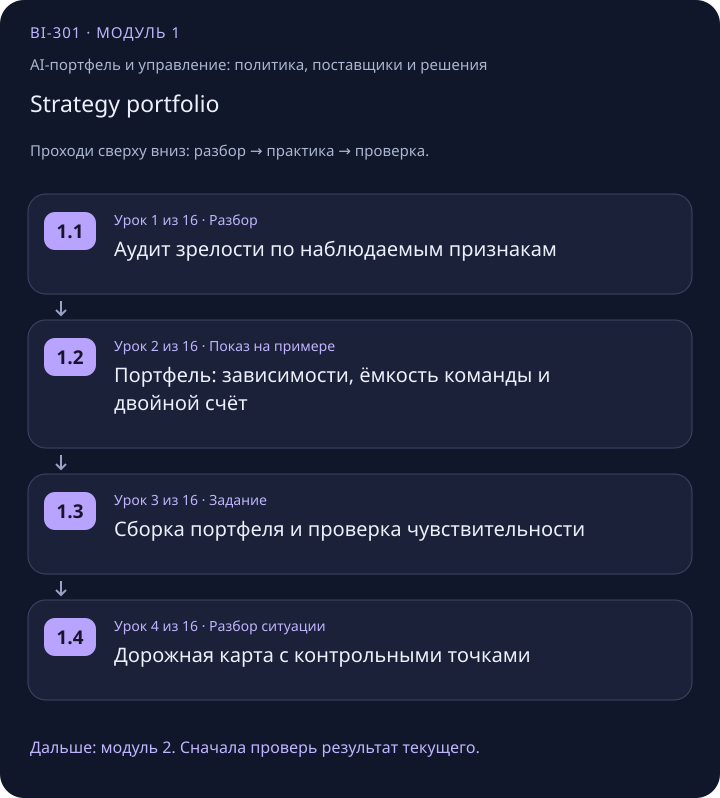
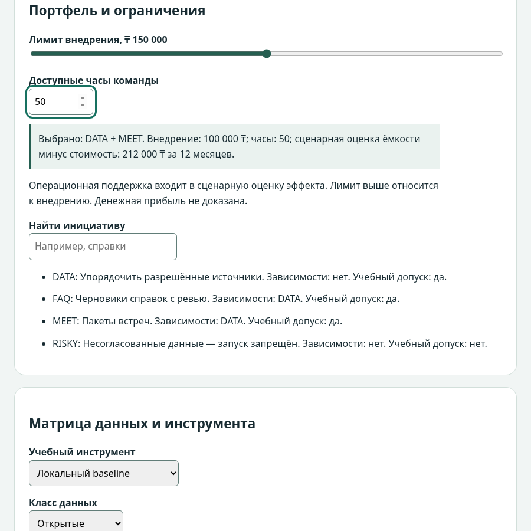

# Модуль 1 из 4 · Strategy portfolio

[← AI-портфель и управление: политика, поставщики и решения · весь порядок уроков](README.md)

Уроки 1–4 из 16. Проходи их сверху вниз: от 1.1 к 1.4, затем к следующему модулю.

Тексты и практика для просмотра. Зачёт, квизы и прогресс выполняются в мини-аппке после публикации материалов.

## В этом модуле

1. [Урок 1 · 1.1 · Аудит зрелости по наблюдаемым признакам](#lesson-bi-301-m1-l1)
2. [Урок 2 · 1.2 · Портфель: зависимости, ёмкость команды и двойной счёт](#lesson-bi-301-m1-l2)
3. [Урок 3 · 1.3 · Сборка портфеля и проверка чувствительности](#lesson-bi-301-m1-l3)
4. [Урок 4 · 1.4 · Дорожная карта с контрольными точками](#lesson-bi-301-m1-l4)

## Урок 1 из 16 · 1.1 · Аудит зрелости по наблюдаемым признакам

Код занятия: `BI-301-M1-L1`.

Это первый урок курса. Дальше двигайся по порядку.

[Следующий урок →: Урок 2 · 1.2 · Портфель: зависимости, ёмкость команды и двойной счёт](M1.md#lesson-bi-301-m1-l2)

Зрелость организации нельзя надёжно определить по числу подписок или самооценке руководителя. Рассматривай данные, качество, роли, обучение, стоимость и работу с исключениями. Для каждого вывода нужен наблюдаемый признак и понятная область проверки.

Составь шкалу: нет практики, есть проба, есть повторяемая процедура, есть проверка и улучшение. Попроси пример процесса, журнал ошибок, фактическое решение владельца и восстановление после сбоя. Отсутствие доказательства не равнозначно доказанной слабости всей компании: помечай неизвестное и ограничение выборки. Учебная мастерская из архива вымышлена; её данные подходят для метода, а не реального рейтинга. Итог аудита должен объяснять ближайший управляемый шаг, а не создавать красивый общий балл без оснований.

### Практика

Подготовь ограниченный аудит по шести направлениям с основаниями, неизвестным и следующей проверкой. Сохрани исходные сведения, свою версию и фактическую проверку. Для AI-инструмента укажи, что действительно запускалось, а что осталось планом. Учебные фикстуры обозначай как синтетические и отделяй их от собственных наблюдений.

### Самопроверка

- Каждая оценка связана с наблюдением
- Область аудита ограничена
- Неизвестное не заменено баллом

### Подсказка

Для одного высокого балла найди пример, когда процедура выдержала ошибку или исключение.

[Практические файлы](https://github.com/ilyasazelkhanov-hash/elaz-ed/raw/refs/heads/main/public/learning/academy/business-lab.zip). В архиве README, готовые учебные примеры и команды проверки. Используй свою копию и приложи результат с объяснением ограничений. Само скачивание не закрывает задание.

## На примере: Шесть свидетельств вместо общего балла

Аудит проверяет наблюдаемую практику в ограниченной области. Факт, интерпретация и неизвестное записываются отдельно.

Вымышленная мастерская «Маяк» проверяет только подготовку клиентских справок за одну неделю. Другие отделы не исследованы.

### Что есть в начале

E1: в реестре 12 источников, у 9 указан владелец. E2: журнал содержит 4 ошибки, у 2 есть результат повторной проверки. E3: описание процесса требует ревью перед отправкой, но примеров отправки нет. E4: владелец процесса письменно остановил один ответ до уточнения факта. E5: есть список 6 участников обучения, самостоятельные работы не сохранены. E6: счёт за инструмент есть, часы поддержки не записаны.

### Разберём по шагам

1. Для направления «данные» запиши факт E1: владельцы указаны у 9 из 12 источников. Вывод «учёт частичный» относится только к этому реестру; уверенность средняя, поскольку актуальность записей не проверена.
2. Для качества используй E2: 2 из 4 ошибок перепроверены. E3 подтверждает наличие требования, но не его соблюдение. Не выводи процент качества всех ответов из журнала ошибок.
3. Разнеси E4 по ролям и исключениям, E5 по обучению, E6 по стоимости. Поставь «неизвестно» для навыка участников и полной стоимости; назначь проверку одной самостоятельной работы и журнала часов.

### Что должно получиться

Матрица из шести направлений: данные, качество, роли, обучение, стоимость, исключения. Например: «обучение → E5 → участие известно, навык неизвестен → низкая уверенность в навыке → проверить новую самостоятельную задачу». Один факт может относиться к двум направлениям, но не превращается в два независимых доказательства.

### Где легко ошибиться

Отсутствие сохранённых работ трактовать как отсутствие навыка у всей организации или заменить неизвестное нулём в рейтинге.

### Проверка примера

Проследи каждый вывод до E1–E6. Для каждого неизвестного назови конкретный документ или наблюдение, которое уменьшит неопределённость.

Пример вымышленный. Он не подтверждает внедрение, фактический AI-вызов или независимое ревью.

## Практика: другие исходные данные

В другой учебной команде «Север»: N1 — 7 источников без дат обновления; N2 — журнал содержит 3 ошибки без повторной проверки; N3 — описан ручной резервный процесс, его запуск не наблюдался; N4 — владелец подтвердил право остановки, примеров нет; N5 — 4 участника выполнили одну задачу, критерии не приложены; N6 — записано 5 часов поддержки, счёт за сервис отсутствует. Составь свою матрицу по шести направлениям с ID свидетельства, выводом, уверенностью и следующей проверкой. Не копируй оценки «Маяка».

### Что нужно сохранить

Подготовь ограниченный аудит по шести направлениям с основаниями, неизвестным и следующей проверкой.

Сохрани входы, свою версию, проверку и ограничения. Подпиши режим: фактический локальный запуск, фактический AI-запуск или анализ готового примера. Отсутствие запуска не считается выполненным запуском.

### Подсказка: исправь причину, а не только ответ

- Если написано «обучение отсутствует», сравни это с N5: запись о работе есть, неизвестен критерий качества. Уточни именно границу вывода.

- Если один общий балл скрывает пробелы, вернись к шести строкам и проверь, где факт подменён предположением.

### Практика: перенос в новый контекст

Для учебного склада известны только инструкция и один журнал восстановления. Определи, что можно сказать о работе с исключениями и какие данные ещё нужны; не составляй рейтинг всего склада.

### Самопроверка: доказательства результата

- Каждая оценка связана с наблюдением

- Область аудита ограничена

- Неизвестное не заменено баллом

Для каждого критерия отметь «нет доказательства», «частично» или «достаточно» и укажи фрагмент своей работы. При пробеле исправь работу и сохрани новую версию с причиной изменения. Это ориентир самопроверки, не автоматический зачёт и не замена действующей рубрики. Проверка работы и статус в Academy выполняются отдельно.

### Результат занятия

Подготовь ограниченный аудит по шести направлениям с основаниями, неизвестным и следующей проверкой.

### Критерии

- Каждая оценка связана с наблюдением
- Область аудита ограничена
- Неизвестное не заменено баллом

### Куда дальше

Это первый урок курса. Дальше двигайся по порядку.

[Следующий урок →: Урок 2 · 1.2 · Портфель: зависимости, ёмкость команды и двойной счёт](M1.md#lesson-bi-301-m1-l2)

## Урок 2 из 16 · 1.2 · Портфель: зависимости, ёмкость команды и двойной счёт

Код занятия: `BI-301-M1-L2`.

[← Предыдущий урок: Урок 1 · 1.1 · Аудит зрелости по наблюдаемым признакам](M1.md#lesson-bi-301-m1-l1)

[Следующий урок →: Урок 3 · 1.3 · Сборка портфеля и проверка чувствительности](M1.md#lesson-bi-301-m1-l3)

Инициативы конкурируют за бюджет и людей и могут зависеть друг от друга. Справочный помощник не готов раньше согласования источников. Два проекта не должны одновременно присваивать себе одну и ту же экономию работы поддержки.

В portfolio.json FAQ и MEET зависят от DATA. Лимит внедрения равен 150000 ₸, трудоёмкость — 70 часов; поддержка отдельно входит в оценку эффекта. RISKY исключён из-за несогласованных данных, несмотря на большой предполагаемый эффект. Поле benefitGroup запрещает двойной счёт одной группы; это упрощённая модель, а не полное распределение совместной выгоды. Изобрази зависимости, найди критическое ограничение и проверь, что при отказе подготовительного проекта зависимые задачи тоже пересматриваются. Циклы и неизвестные зависимости должны обнаруживаться до выбора.

### Практика

Построй карту четырёх инициатив с зависимостями, общими ресурсами и правилами учёта эффекта. Сохрани исходные сведения, свою версию и фактическую проверку. Для AI-инструмента укажи, что действительно запускалось, а что осталось планом. Учебные фикстуры обозначай как синтетические и отделяй их от собственных наблюдений.

### Самопроверка

- Зависимости проверены на циклы
- Люди и бюджет ограничены
- Общая выгода не посчитана дважды

### Подсказка

Удали проект подготовки данных и проверь, какие остальные инициативы теряют основание для запуска.

[Практические файлы](https://github.com/ilyasazelkhanov-hash/elaz-ed/raw/refs/heads/main/public/learning/academy/business-lab.zip). В архиве README, готовые учебные примеры и команды проверки. Используй свою копию и приложи результат с объяснением ограничений. Само скачивание не закрывает задание.

## На примере: Карта зависимости и общей выгоды

Карта отделяет необходимый предварительный шаг от желательного. Общая экономия не складывается дважды.

Та же мастерская «Маяк» планирует четыре инициативы. Здесь строится карта, а не выбирается победитель по цене.

### Что есть в начале

DATA: 30000 ₸, 10 ч, без зависимостей. FAQ: 50000 ₸, 25 ч, зависит от DATA. MEET: 60000 ₸, 30 ч, зависит от DATA. SEARCH: 20000 ₸, 15 ч, зависит от DATA. FAQ и SEARCH уменьшают одни и те же 20 часов поддержки в месяц. Лимиты: 100000 ₸ и 40 ч.

### Разберём по шагам

1. Нарисуй стрелки DATA → FAQ, DATA → MEET и DATA → SEARCH. Порядок DATA, затем остальные доказывает отсутствие цикла в этой карте.
2. Отметь FAQ и SEARCH общей группой SUPPORT: заявленные 20 часов не становятся 40 часами при одновременном выборе.
3. Проверь карту отказом DATA: все три зависимые инициативы теряют готовность. Запиши общие лимиты отдельно от затрат отдельных инициатив.

### Что должно получиться

Четыре узла, три зависимости, одна общая группа выгоды и два ограничения. Карта показывает, почему FAQ+SEARCH без DATA недопустим даже при подходящей цене.

### Где легко ошибиться

Принять стрелку «полезно иметь» за обязательную зависимость или прибавить две оценки одной и той же работы поддержки.

### Проверка примера

Сможешь ли ты для каждой стрелки объяснить, что невозможно сделать без предшественника? Есть ли цикл и пересечение выгоды?

Пример вымышленный. Он не подтверждает внедрение, фактический AI-вызов или независимое ревью.

## Практика: другие исходные данные

Построй новую карту: CLEAN — 20000 ₸/8 ч; TAG — 35000 ₸/16 ч после CLEAN; REPLY — 45000 ₸/20 ч после CLEAN; REPORT — 25000 ₸/12 ч после TAG. TAG и REPLY заявляют одни и те же 12 часов экономии. Лимиты 90000 ₸/36 ч. Отметь пересечение и последствия отмены CLEAN; проверь вариант с ошибочной зависимостью CLEAN от REPORT.

### Что нужно сохранить

Построй карту четырёх инициатив с зависимостями, общими ресурсами и правилами учёта эффекта.

Сохрани входы, свою версию, проверку и ограничения. Подпиши режим: фактический локальный запуск, фактический AI-запуск или анализ готового примера. Отсутствие запуска не считается выполненным запуском.

### Подсказка: исправь причину, а не только ответ

- Если карта допускает старт REPORT раньше TAG, проверь направление обязательной стрелки.

- Если сумма выгоды удвоилась, назови конкретную работу, время которой сокращают оба проекта, и учти её только один раз.

### Практика: перенос в новый контекст

Для учебного отдела продаж с CRM, черновиками писем и отчётами выдели одну обязательную зависимость и одну лишь удобную связь. Объясни различие без цен.

### Самопроверка: доказательства результата

- Зависимости проверены на циклы

- Люди и бюджет ограничены

- Общая выгода не посчитана дважды

Для каждого критерия отметь «нет доказательства», «частично» или «достаточно» и укажи фрагмент своей работы. При пробеле исправь работу и сохрани новую версию с причиной изменения. Это ориентир самопроверки, не автоматический зачёт и не замена действующей рубрики. Проверка работы и статус в Academy выполняются отдельно.

### Результат занятия

Построй карту четырёх инициатив с зависимостями, общими ресурсами и правилами учёта эффекта.

### Критерии

- Зависимости проверены на циклы
- Люди и бюджет ограничены
- Общая выгода не посчитана дважды

### Куда дальше

[← Предыдущий урок: Урок 1 · 1.1 · Аудит зрелости по наблюдаемым признакам](M1.md#lesson-bi-301-m1-l1)

[Следующий урок →: Урок 3 · 1.3 · Сборка портфеля и проверка чувствительности](M1.md#lesson-bi-301-m1-l3)

## Урок 3 из 16 · 1.3 · Сборка портфеля и проверка чувствительности

Код занятия: `BI-301-M1-L3`.

[← Предыдущий урок: Урок 2 · 1.2 · Портфель: зависимости, ёмкость команды и двойной счёт](M1.md#lesson-bi-301-m1-l2)

[Следующий урок →: Урок 4 · 1.4 · Дорожная карта с контрольными точками](M1.md#lesson-bi-301-m1-l4)

Скриншот после изменения часов в синтетическом портфеле. Сопоставь выбор с зависимостями и лимитом внедрения; бюджет не утверждается.

Портфель выбирает допустимое сочетание, а не первую инициативу в рейтинге. В choosePortfolio перебираются комбинации до двенадцати проектов; недопустимые отсекаются по данным, зависимостям, бюджету, трудоёмкости и пересекающейся выгоде. Пустой портфель допустим, если все варианты имеют отрицательную оценку.

Для учебных допущений выбираются DATA и FAQ: внедрение 120000 ₸, 60 часов и сценарная чистая оценка ёмкости 240000 ₸ за год. При лимите 50 часов выбор меняется на DATA и MEET. Эти величины не доказывают прибыль, а отметка approved в фикстуре не выдаёт реального разрешения. Измени частоту использования и поддержку, покажи границу изменения выбора. Сопоставь модель с качественными ограничениями, которые она не учитывает, и предложи проверку перед настоящим решением.

### Практика

Рассчитай два портфеля при разных ограничениях и объясни изменение выбора и слабые места модели. Сохрани исходные сведения, свою версию и фактическую проверку. Для AI-инструмента укажи, что действительно запускалось, а что осталось планом. Учебные фикстуры обозначай как синтетические и отделяй их от собственных наблюдений.

### Самопроверка

- Комбинации удовлетворяют ограничениям
- Чувствительность показана на числах
- Модель не объявлена фактическим разрешением бюджета

### Подсказка

Не заставляй модель потратить весь бюджет: иногда разумнее оставить резерв или ничего не запускать.

[Практические файлы](https://github.com/ilyasazelkhanov-hash/elaz-ed/raw/refs/heads/main/public/learning/academy/business-lab.zip). В архиве README, готовые учебные примеры и команды проверки. Используй свою копию и приложи результат с объяснением ограничений. Само скачивание не закрывает задание.

## На примере: Два лимита меняют допустимый портфель

Сначала проверяются допустимость и ограничения, затем сравнивается эффект. Чувствительность означает изменение одного допущения при остальных неизменных.

«Маяк» сравнивает две независимые альтернативы после подготовки DATA. Данные этого мини-примера не заменяют portfolio.json из архива.

### Что есть в начале

DATA: 30000 ₸/10 ч; FAQ: 50000 ₸/25 ч, эффект сценарно 12 ч/месяц; MEET: 60000 ₸/30 ч, эффект 15 ч/месяц. Оба требуют DATA. Бюджет внедрения 100000 ₸; начальная ёмкость 40 ч. Поддержка и качество пока не оценены.

### Разберём по шагам

1. Проверь DATA+FAQ: 80000 ₸ и 35 ч; DATA+MEET: 90000 ₸ и 40 ч. Все три вместе требуют 140000 ₸ и 65 ч, поэтому исключены.
2. При 40 ч вариант DATA+MEET имеет большую заявленную экономию времени, но это только условный выбор при равном качестве и поддержке.
3. Уменьши только лимит до 35 ч: DATA+MEET больше не проходит, DATA+FAQ остаётся. Не меняй одновременно стоимость и эффект.

### Что должно получиться

Две таблицы допустимости, одна изменённая переменная и условная рекомендация. Смена выбора объясняется ограничением часов, не улучшением самого FAQ.

### Где легко ошибиться

Выдать предполагаемую ёмкость за денежную прибыль или сравнивать варианты по разным горизонтам и разному качеству.

### Проверка примера

Пересчитай обе суммы и покажи отвергнутую комбинацию. Что изменится, если поддержка MEET поглотит его преимущество?

Пример вымышленный. Он не подтверждает внедрение, фактический AI-вызов или независимое ревью.

## Практика: другие исходные данные

Новый набор: PREP 25000 ₸/8 ч; NOTES 45000 ₸/22 ч с эффектом 9 ч/месяц; HELP 55000 ₸/28 ч с эффектом 13 ч/месяц. Оба зависят от PREP. Бюджет 85000 ₸. Рассчитай варианты сначала при 36 ч, затем при 30 ч. Покажи все суммы и назови недостающие данные для решения.

### Что нужно сохранить

Рассчитай два портфеля при разных ограничениях и объясни изменение выбора и слабые места модели.

Сохрани входы, свою версию, проверку и ограничения. Подпиши режим: фактический локальный запуск, фактический AI-запуск или анализ готового примера. Отсутствие запуска не считается выполненным запуском.

### Подсказка: исправь причину, а не только ответ

- Если выбран HELP при лимите 30 ч, включи в сумму часы PREP.

- Если объявлена прибыль, отдели оценку сэкономленного времени от фактических денежных поступлений и расходов.

### Практика: перенос в новый контекст

Сохрани часы, но сократи бюджет нового набора до 65000 ₸. Объясни, почему отказ от запуска может быть обоснованным результатом, и предложи меньший следующий шаг.

### Самопроверка: доказательства результата

- Комбинации удовлетворяют ограничениям

- Чувствительность показана на числах

- Модель не объявлена фактическим разрешением бюджета

Для каждого критерия отметь «нет доказательства», «частично» или «достаточно» и укажи фрагмент своей работы. При пробеле исправь работу и сохрани новую версию с причиной изменения. Это ориентир самопроверки, не автоматический зачёт и не замена действующей рубрики. Проверка работы и статус в Academy выполняются отдельно.

### Результат занятия

Рассчитай два портфеля при разных ограничениях и объясни изменение выбора и слабые места модели.

### Критерии

- Комбинации удовлетворяют ограничениям
- Чувствительность показана на числах
- Модель не объявлена фактическим разрешением бюджета

### Куда дальше

[← Предыдущий урок: Урок 2 · 1.2 · Портфель: зависимости, ёмкость команды и двойной счёт](M1.md#lesson-bi-301-m1-l2)

[Следующий урок →: Урок 4 · 1.4 · Дорожная карта с контрольными точками](M1.md#lesson-bi-301-m1-l4)

## Урок 4 из 16 · 1.4 · Дорожная карта с контрольными точками

Код занятия: `BI-301-M1-L4`.

[← Предыдущий урок: Урок 3 · 1.3 · Сборка портфеля и проверка чувствительности](M1.md#lesson-bi-301-m1-l3)

[Следующий урок →: Урок 5 · 2.1 · Данные, безопасность и минимально нужный контекст](M2.md#lesson-bi-301-m2-l1)

Дорожная карта связывает инициативы с условиями начала и перехода, а не только датами. Подготовка источников должна пройти проверку до расширения помощника; недостигнутый критерий меняет план, а не скрывается переносом полосы на диаграмме.

Для выбранного портфеля определи этап подготовки, ограниченный пилот, ревью и возможное расширение. На каждом этапе укажи владельца, необходимые данные, лимит расходов, критерий качества и условие остановки. Учти общую загрузку проверяющего и резерв на исправления. Согласуй решение с владельцами фактически; учебное представление не заменяет комитет. На защите покажи альтернативу при недоступном поставщике и при меньшей ёмкости команды. Даты называй плановыми, если нет подтверждённого исполнения.

### Практика

Защити дорожную карту портфеля с зависимостями, лимитами и условиями перехода между этапами. Сохрани исходные сведения, свою версию и фактическую проверку. Для AI-инструмента укажи, что действительно запускалось, а что осталось планом. Учебные фикстуры обозначай как синтетические и отделяй их от собственных наблюдений.

### Самопроверка

- Этапы имеют проверяемые условия
- Общая нагрузка команды учтена
- Есть альтернативный маршрут

### Подсказка

На каждом этапе допиши фразу: «переходим дальше, только если проверено…».

[Практические файлы](https://github.com/ilyasazelkhanov-hash/elaz-ed/raw/refs/heads/main/public/learning/academy/business-lab.zip). В архиве README, готовые учебные примеры и команды проверки. Используй свою копию и приложи результат с объяснением ограничений. Само скачивание не закрывает задание.

## На примере: Контрольная практика: переход разрешает свидетельство

Дорожная карта связывает этап с проверяемым выходом и возможностью остановки. Дата в календаре не является доказательством готовности.

«Маяк» готовит DATA+FAQ за ограниченные 35 часов команды. Нужно объяснить переход от реестра к пилоту.

### Что есть в начале

DATA занимает 10 ч; FAQ — 25 ч. Для DATA требуется согласованный список источников. Для FAQ задан учебный порог: не менее 9 из 10 корректных черновиков и ни одного ответа с запрещёнными данными. Реальные результаты пока не собраны.

### Разберём по шагам

1. Этап 1 отдаёт проверенный реестр владельцу процесса; пока источник не согласован, FAQ работает только на синтетических данных.
2. На этапе 2 резервируй часы на проверку, а не только создание. Переход к ограниченному пилоту зависит от журнала 10 задач и проверки запретов, а не от наступления пятницы.
3. Назначь условного владельца решения и маршрут при провале: исправить на синтетике или оставить ручную обработку. Это план ролей, не фактическое согласие человека.

### Что должно получиться

Три контрольные точки: вход, проверка, решение. Для каждой указаны свидетельство, владелец, лимит и действие при провале; сумма запланированных часов не превышает 35.

### Где легко ошибиться

Заложить 35 часов на сборку и добавить проверку сверх лимита, либо объявить условие уже выполненным.

### Проверка примера

Что именно должен увидеть владелец для перехода? Найди в карте резерв на проверку и путь при несогласованном источнике.

Пример вымышленный. Он не подтверждает внедрение, фактический AI-вызов или независимое ревью.

## Практика: контрольная работа

Контрольная работа модуля: по своему набору PREP/NOTES/HELP из урока 1.3 собери пакет «свидетельства → зависимости → два портфеля → дорожная карта». Доступно 30 часов, из них 6 на проверку; не считай эти часы дважды. Если исходная оценка сборки не помещается, явно сократи объём или отложи запуск. Приложи одну отвергнутую альтернативу и причины.

### Что нужно сохранить

Защити дорожную карту портфеля с зависимостями, лимитами и условиями перехода между этапами.

Сохрани входы, свою версию, проверку и ограничения. Подпиши режим: фактический локальный запуск, фактический AI-запуск или анализ готового примера. Отсутствие запуска не считается выполненным запуском.

### Подсказка: исправь причину, а не только ответ

- Если этап не имеет проверяемого выхода, замени «готово к пятнице» на конкретный журнал, документ или результат проверки.

- Если план не помещается, не уменьшай оценки молча: покажи изменение объёма и его последствия.

### Практика: перенос в новый контекст

Команда доступна лишь 18 часов, а владельца данных ещё нет. Защити минимальный полезный шаг без запуска внешнего AI и без выдуманного согласования.

### Самопроверка: доказательства результата

- Этапы имеют проверяемые условия

- Общая нагрузка команды учтена

- Есть альтернативный маршрут

Для каждого критерия отметь «нет доказательства», «частично» или «достаточно» и укажи фрагмент своей работы. При пробеле исправь работу и сохрани новую версию с причиной изменения. Это ориентир самопроверки, не автоматический зачёт и не замена действующей рубрики. Проверка работы и статус в Academy выполняются отдельно.

### Результат занятия

Защити дорожную карту портфеля с зависимостями, лимитами и условиями перехода между этапами.

### Критерии

- Этапы имеют проверяемые условия
- Общая нагрузка команды учтена
- Есть альтернативный маршрут

### Куда дальше

[← Предыдущий урок: Урок 3 · 1.3 · Сборка портфеля и проверка чувствительности](M1.md#lesson-bi-301-m1-l3)

[Следующий урок →: Урок 5 · 2.1 · Данные, безопасность и минимально нужный контекст](M2.md#lesson-bi-301-m2-l1)

## Проверенные источники

- [OWASP: GenAI application risks](https://github.com/OWASP/www-project-top-10-for-large-language-model-applications) · проверено 2026-10-27
- [W3C TAG: Privacy Principles](https://github.com/w3ctag/privacy-principles) · проверено 2026-10-27

## Переход между модулями

Это первый модуль курса.

[Модуль 2: Data, Ethics & Risk →](M2.md#lesson-bi-301-m2-l1)
