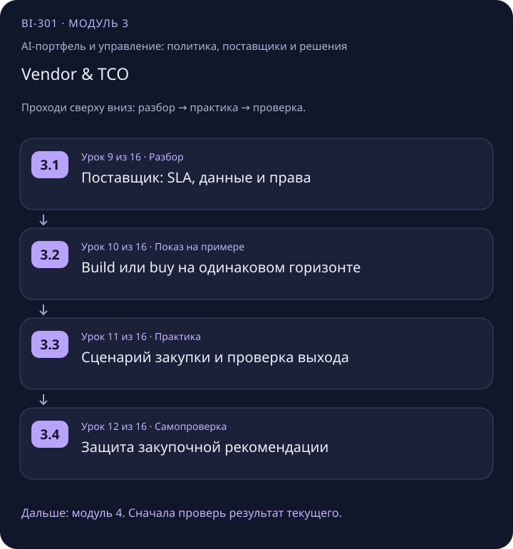

# Модуль 3 из 4 · Vendor & TCO

[← AI-портфель и управление: политика, поставщики и решения · весь порядок уроков](README.md)

Уроки 9–12 из 16. Проходи их сверху вниз: от 3.1 к 3.4, затем к следующему модулю.

Тексты и практика для просмотра. Зачёт, квизы и прогресс выполняются в мини-аппке после публикации материалов.

## В этом модуле

1. [Урок 9 · 3.1 · Поставщик: SLA, данные и права](#lesson-bi-301-m3-l1)
2. [Урок 10 · 3.2 · Build или buy на одинаковом горизонте](#lesson-bi-301-m3-l2)
3. [Урок 11 · 3.3 · Сценарий закупки и проверка выхода](#lesson-bi-301-m3-l3)
4. [Урок 12 · 3.4 · Защита закупочной рекомендации](#lesson-bi-301-m3-l4)

## Урок 9 из 16 · 3.1 · Поставщик: SLA, данные и права

Код занятия: `BI-301-M3-L1`.

[← Предыдущий урок: Урок 8 · 2.4 · Комитет и инцидент: решение с основаниями](M2.md#lesson-bi-301-m2-l4)

[Следующий урок →: Урок 10 · 3.2 · Build или buy на одинаковом горизонте](M3.md#lesson-bi-301-m3-l2)

Поставщика оценивают по условиям конкретного применения. Название модели и обещание «данные защищены» не отвечают на вопросы хранения, обучения на данных, доступа, удаления и прав на результат. Проверяй документы с датой, версией и применимой областью.

Используй vendor-review.md. Для каждого обязательного условия укажи подтверждение, неизвестное и владельца проверки. SLA должен объяснять доступность, поддержку, ограничения ответственности и действия при изменении сервиса; он не гарантирует смысловую правильность каждого ответа. Права на входные материалы, условия результата и использование сторонних объектов рассматриваются отдельно. В procurement.json нет настоящих предложений и подписанных договоров. Не делай юридический вывод из учебного примера: вопросы договора передаются полномочному специалисту. Отсутствие подтверждения отмечай как незакрытое условие выбора.

### Практика

Собери матрицу проверки поставщика с документальными основаниями и блокирующими неизвестными. Сохрани исходные сведения, свою версию и фактическую проверку. Для AI-инструмента укажи, что действительно запускалось, а что осталось планом. Учебные фикстуры обозначай как синтетические и отделяй их от собственных наблюдений.

### Самопроверка

- Условия привязаны к сценарию
- Документ, версия и дата записаны
- Юридические и технические вопросы различены

### Подсказка

Попроси показать, какое именно условие подтверждает допустимость ваших данных, а не сервиса вообще.

[Практические файлы](https://github.com/ilyasazelkhanov-hash/elaz-ed/raw/refs/heads/main/public/learning/academy/business-lab.zip). В архиве README, готовые учебные примеры и команды проверки. Используй свою копию и приложи результат с объяснением ограничений. Само скачивание не закрывает задание.

## На примере: Условия поставщика: обещание не равно документу

Проверка поставщика привязывает каждый обязательный вопрос к документу, версии и нужному сценарию. Технический тест не заменяет проверку прав.

«Маяк» изучает вымышленный сервис A для внутренних протоколов. Закупка и передача данных не выполняются.

### Что есть в начале

V1: рекламный лист обещает «безопасный AI», даты нет. V2: учебное SLA v1 от 2026-10-01 относится только к доступности, не качеству ответов. V3: пример экспорта есть, восстановление не проверено. Условия хранения, удаления и прав на входные данные отсутствуют.

### Разберём по шагам

1. Для доступности сошлись на V2 с датой и областью; не переноси обещание SLA на точность модели.
2. Для внутренних данных поставь блокирующие неизвестные: основание обработки, хранение, удаление, доступ и права. V1 не закрывает эти вопросы.
3. Раздели вопросы договорных условий и технические испытания: прочитать условия удаления и проверить удаление на тестовом наборе — разные действия.

### Что должно получиться

Матрица «требование → источник/версия/дата → подтверждено или неизвестно → блокирует ли сценарий → следующая проверка». Нет заключения о реальной пригодности поставщика.

### Где легко ошибиться

Превратить рекламное обещание в подтверждённую гарантию или написать «права проверены» после успешного экспорта.

### Проверка примера

Для каждого «подтверждено» найди точный документ и область. Какие неизвестные запрещают внутренние данные?

Пример вымышленный. Он не подтверждает внедрение, фактический AI-вызов или независимое ревью.

## Практика: другие исходные данные

Для вымышленного сервиса B даны: спецификация API v2 от 2026-10-03 с полем export; тариф от 2026-10-04 без стоимости выхода; учебное соглашение обработки данных без списка субподрядчиков. Составь свою матрицу для публичных справок и отдельно внутренних протоколов. Не придумывай недостающие условия.

### Что нужно сохранить

Собери матрицу проверки поставщика с документальными основаниями и блокирующими неизвестными.

Сохрани входы, свою версию, проверку и ограничения. Подпиши режим: фактический локальный запуск, фактический AI-запуск или анализ готового примера. Отсутствие запуска не считается выполненным запуском.

### Подсказка: исправь причину, а не только ответ

- Если оба сценария допущены одинаково, проверь, какие требования появляются из-за внутренних данных.

- Если поле export принято за проверку выхода, попроси воспроизводимый экспорт и восстановление на образце.

### Практика: перенос в новый контекст

Поставщик обновил условия после ревью. Определи, какие строки матрицы стали требовать повторной проверки и почему старое решение не переносится автоматически.

### Самопроверка: доказательства результата

- Условия привязаны к сценарию

- Документ, версия и дата записаны

- Юридические и технические вопросы различены

Для каждого критерия отметь «нет доказательства», «частично» или «достаточно» и укажи фрагмент своей работы. При пробеле исправь работу и сохрани новую версию с причиной изменения. Это ориентир самопроверки, не автоматический зачёт и не замена действующей рубрики. Проверка работы и статус в Academy выполняются отдельно.

### Результат занятия

Собери матрицу проверки поставщика с документальными основаниями и блокирующими неизвестными.

### Критерии

- Условия привязаны к сценарию
- Документ, версия и дата записаны
- Юридические и технические вопросы различены

### Куда дальше

[← Предыдущий урок: Урок 8 · 2.4 · Комитет и инцидент: решение с основаниями](M2.md#lesson-bi-301-m2-l4)

[Следующий урок →: Урок 10 · 3.2 · Build или buy на одинаковом горизонте](M3.md#lesson-bi-301-m3-l2)

## Урок 10 из 16 · 3.2 · Build или buy на одинаковом горизонте

Код занятия: `BI-301-M3-L2`.

[← Предыдущий урок: Урок 9 · 3.1 · Поставщик: SLA, данные и права](M3.md#lesson-bi-301-m3-l1)

[Следующий урок →: Урок 11 · 3.3 · Сценарий закупки и проверка выхода](M3.md#lesson-bi-301-m3-l3)

Собственная разработка даёт другой контроль и другую ответственность; готовый сервис переносит часть работ, но не отменяет интеграцию, ревью и выход. Сравнивай одинаковый объём, качество и горизонт, включая поддержку команды.

В procurement.json вымышленные варианты за три месяца стоят 180400, 224600 и 282000 ₸ по указанной формуле. Налоги, миграция и юридическая проверка неизвестны; таблица должна показывать их как неизвестное, а не ноль. Более дешёвый вариант с неподтверждёнными условиями данных пока не допустим к окончательному выбору. Добавь ручной вариант как альтернативу. Для собственного расчёта сохрани исходные ставки, оценку часов и погрешность. Укажи, кто поддерживает внутреннее решение при уходе автора. Выбор зависит от требований и возможности владения, а не от лозунга о преимуществах своей разработки.

### Практика

Сравни сервис, внутреннее решение и ручной путь по одному TCO-контракту. Сохрани исходные сведения, свою версию и фактическую проверку. Для AI-инструмента укажи, что действительно запускалось, а что осталось планом. Учебные фикстуры обозначай как синтетические и отделяй их от собственных наблюдений.

### Самопроверка

- Объём и качество сопоставимы
- Неизвестные расходы видны
- Есть владелец поддержки и выхода

### Подсказка

Проверь, не оплачивается ли один час команды одновременно в настройке и ежемесячной поддержке.

[Практические файлы](https://github.com/ilyasazelkhanov-hash/elaz-ed/raw/refs/heads/main/public/learning/academy/business-lab.zip). В архиве README, готовые учебные примеры и команды проверки. Используй свою копию и приложи результат с объяснением ограничений. Само скачивание не закрывает задание.

## На примере: Сопоставимый TCO включает ручную альтернативу

TCO сравнивает одинаковый объём, период и требуемое качество. Дешевле не означает допустимо.

«Маяк» считает учебные затраты на 480 задач за три месяца. Это отдельный расчётный пример, а не коммерческие предложения.

### Что есть в начале

SERVICE: внедрение 40000 ₸, инструменты 12000 ₸/мес, поддержка 30000 ₸/мес, 30 ₸/задачу. BUILD: 120000 ₸, 20000 ₸/мес, 30000 ₸/мес, 25 ₸/задачу. MANUAL: 15 минут/задачу при 4000 ₸/ч, без внедрения. Эквивалентное качество и стоимость выхода ещё не проверены.

### Разберём по шагам

1. SERVICE: 40000 + 3×(12000+30000) + 480×30 = 180400 ₸. BUILD: 120000 + 3×(20000+30000) + 480×25 = 282000 ₸.
2. MANUAL: 480×15/60×4000 = 480000 ₸ оценки труда. Это не обязательно дополнительные денежные выплаты, поэтому подпиши вид затрат.
3. Отдельно перечисли неизвестные: ревью, выход, налоги и подтверждение равного качества. Назначь предлагаемого владельца поддержки; вывод остаётся условным.

### Что должно получиться

Одна таблица на 3 месяца и 480 задач с формулами, известными расходами и открытыми статьями. Разница TCO не объявляется реализованной экономией.

### Где легко ошибиться

Сравнить месячную подписку с полным внедрением либо забыть труд проверки AI-ответов.

### Проверка примера

Повтори расчёт из входных строк. Какие статьи могли бы изменить ранжирование и кто будет поддерживать решение?

Пример вымышленный. Он не подтверждает внедрение, фактический AI-вызов или независимое ревью.

## Практика: другие исходные данные

Новый объём 100 задач/месяц на 6 месяцев. SERVICE: внедрение 30000 ₸, 10000 ₸/месяц, поддержка 15000 ₸/месяц, 40 ₸/задачу; BUILD: 90000 ₸, 8000 ₸/месяц, поддержка 18000 ₸/месяц, 15 ₸/задачу; MANUAL: 12 минут/задачу при 3500 ₸/ч. Посчитай TCO, подпиши тип затрат и добавь неизвестные расходы и владельца выхода.

### Что нужно сохранить

Сравни сервис, внутреннее решение и ручной путь по одному TCO-контракту.

Сохрани входы, свою версию, проверку и ограничения. Подпиши режим: фактический локальный запуск, фактический AI-запуск или анализ готового примера. Отсутствие запуска не считается выполненным запуском.

### Подсказка: исправь причину, а не только ответ

- Если сумма задач равна 100, учти весь шестимесячный горизонт.

- Если ручной путь назван бесплатным, посчитай труд отдельно от дополнительных денежных расходов.

### Практика: перенос в новый контекст

Добавь обязательные 8 минут ревью каждой AI-задачи по 3500 ₸/ч. Проверь, меняется ли вывод, не изменяя остальные допущения.

### Самопроверка: доказательства результата

- Объём и качество сопоставимы

- Неизвестные расходы видны

- Есть владелец поддержки и выхода

Для каждого критерия отметь «нет доказательства», «частично» или «достаточно» и укажи фрагмент своей работы. При пробеле исправь работу и сохрани новую версию с причиной изменения. Это ориентир самопроверки, не автоматический зачёт и не замена действующей рубрики. Проверка работы и статус в Academy выполняются отдельно.

### Результат занятия

Сравни сервис, внутреннее решение и ручной путь по одному TCO-контракту.

### Критерии

- Объём и качество сопоставимы
- Неизвестные расходы видны
- Есть владелец поддержки и выхода

### Куда дальше

[← Предыдущий урок: Урок 9 · 3.1 · Поставщик: SLA, данные и права](M3.md#lesson-bi-301-m3-l1)

[Следующий урок →: Урок 11 · 3.3 · Сценарий закупки и проверка выхода](M3.md#lesson-bi-301-m3-l3)

## Урок 11 из 16 · 3.3 · Сценарий закупки и проверка выхода

Код занятия: `BI-301-M3-L3`.

[← Предыдущий урок: Урок 10 · 3.2 · Build или buy на одинаковом горизонте](M3.md#lesson-bi-301-m3-l2)

[Следующий урок →: Урок 12 · 3.4 · Защита закупочной рекомендации](M3.md#lesson-bi-301-m3-l4)

Закупочное решение должно пережить изменение цены, лимита или качества. Заранее определи переносимость данных, формат экспорта, альтернативный маршрут и условия прекращения использования. Наличие кнопки Export не доказывает полноту восстановления процесса.

Составь три сценария: базовый, падение использования и недоступность поставщика. Для каждого пересчитай стоимость, нагрузку ревью и ограничения. Проведи локальную репетицию выхода на разрешённых фикстурах: выгрузи пакет, проверь поля и открой его в независимом просмотре. Она подтверждает только проверенный формат, не будущую совместимость внешнего сервиса. Если реальный экспорт не запускался, оставь not_run. Сохрани перечень невосстановленных частей и стоимость ручного пути. Договорённость о выходе, фактическая выгрузка и успешное восстановление — разные этапы.

### Практика

Подготовь три закупочных сценария и журнал репетиции выхода с проверкой полноты. Сохрани исходные сведения, свою версию и фактическую проверку. Для AI-инструмента укажи, что действительно запускалось, а что осталось планом. Учебные фикстуры обозначай как синтетические и отделяй их от собственных наблюдений.

### Самопроверка

- Сценарии меняют существенные допущения
- Выход проверяется на артефакте
- Незапущенные проверки не объявлены успешными

### Подсказка

Открой экспорт в чистой папке и найди всё, что требуется следующему владельцу для продолжения работы.

[Практические файлы](https://github.com/ilyasazelkhanov-hash/elaz-ed/raw/refs/heads/main/public/learning/academy/business-lab.zip). В архиве README, готовые учебные примеры и команды проверки. Используй свою копию и приложи результат с объяснением ограничений. Само скачивание не закрывает задание.

## На примере: Экспорт проверяется восстановлением

Репетиция выхода проверяет полноту и пригодность данных у другой стороны или в ручном процессе, а не только наличие файла.

«Маяк» моделирует смену поставщика на трёх синтетических записях. Внешний сервис не используется.

### Что есть в начале

Ожидаемые ID: A1, A2, A3. В учебном export.json: A1 с полным текстом, A2 без источника, A2 повторно. Схема требует уникальный ID, текст и source_id. Для закупки рассматриваются базовый объём, удвоенный объём и прекращение сервиса.

### Разберём по шагам

1. Сверь множество ID и схему: A3 отсутствует, A2 дублируется и не имеет обязательного источника. Три строки не означают три восстановленные записи.
2. На учебной копии восстанови записи в простую таблицу и проверь связи source_id. Если восстановление только описано, отметь «не запускалось».
3. Для трёх сценариев укажи изменение нагрузки или срока выхода и владельца. Не ставь успешный выход при неполном экспорте.

### Что должно получиться

Журнал расхождений по ID и полям, результат фактической репетиции либо честный план, три сценария с последствиями для закупки.

### Где легко ошибиться

Принять размер файла или число строк за полноту переноса и выдать план восстановления за выполненный тест.

### Проверка примера

Есть ли исходное множество ID и результаты проверки каждого обязательного поля? Можно ли прочитать восстановленную запись без исходного сервиса?

Пример вымышленный. Он не подтверждает внедрение, фактический AI-вызов или независимое ревью.

## Практика: другие исходные данные

Создай на учебной копии четыре записи B1–B4 с полями id/text/source_id. Подготовь экспорт, намеренно убрав source_id у B3 и запись B4. Сохрани исходник, экспорт, найденные расхождения и исправленную версию. Составь три сценария: обычный объём, рост вдвое, закрытие сервиса за 7 дней. Никакие реальные данные не загружай.

### Что нужно сохранить

Подготовь три закупочных сценария и журнал репетиции выхода с проверкой полноты.

Сохрани входы, свою версию, проверку и ограничения. Подпиши режим: фактический локальный запуск, фактический AI-запуск или анализ готового примера. Отсутствие запуска не считается выполненным запуском.

### Подсказка: исправь причину, а не только ответ

- Если проверяется только количество, сравни множества идентификаторов и обязательные поля.

- Если исправленная версия объявлена полной, повтори те же проверки и запиши наблюдаемый результат, а не только намерение.

### Практика: перенос в новый контекст

Новый экспорт сохраняет все тексты, но теряет даты и права доступа. Определи, пригоден ли он для конкретного процесса и что должно блокировать миграцию.

### Самопроверка: доказательства результата

- Сценарии меняют существенные допущения

- Выход проверяется на артефакте

- Незапущенные проверки не объявлены успешными

Для каждого критерия отметь «нет доказательства», «частично» или «достаточно» и укажи фрагмент своей работы. При пробеле исправь работу и сохрани новую версию с причиной изменения. Это ориентир самопроверки, не автоматический зачёт и не замена действующей рубрики. Проверка работы и статус в Academy выполняются отдельно.

### Результат занятия

Подготовь три закупочных сценария и журнал репетиции выхода с проверкой полноты.

### Критерии

- Сценарии меняют существенные допущения
- Выход проверяется на артефакте
- Незапущенные проверки не объявлены успешными

### Куда дальше

[← Предыдущий урок: Урок 10 · 3.2 · Build или buy на одинаковом горизонте](M3.md#lesson-bi-301-m3-l2)

[Следующий урок →: Урок 12 · 3.4 · Защита закупочной рекомендации](M3.md#lesson-bi-301-m3-l4)

## Урок 12 из 16 · 3.4 · Защита закупочной рекомендации

Код занятия: `BI-301-M3-L4`.

[← Предыдущий урок: Урок 11 · 3.3 · Сценарий закупки и проверка выхода](M3.md#lesson-bi-301-m3-l3)

[Следующий урок →: Урок 13 · 4.1 · AI lead и центр компетенций с понятной ответственностью](M4.md#lesson-bi-301-m4-l1)

Рекомендация начинается с условий задачи, допустимых вариантов и основания выбора. Таблица баллов помогает сравнить, но не отменяет обязательные условия, риски и отсутствие доказательств. Укажи, кто имеет право принять решение и какие вопросы ещё открыты.

Защити один из вариантов procurement.json как условную рекомендацию, а не состоявшуюся закупку. Все предложения вымышлены, реальные проверки условий не выполнены. Объясни, какие документы и тесты нужны до решения, что произойдёт при неудаче и почему ручной путь остаётся альтернативой. Для собственного проекта приложи фактические источники стоимости, TCO, качество, ограничения и план выхода. Не выдавай подготовку письма поставщику за отправку, а проект согласования за подпись. Зафиксируй дату пересмотра и триггер повторного сравнения.

### Практика

Защити условную закупочную рекомендацию с блокирующими вопросами, альтернативой и планом выхода. Сохрани исходные сведения, свою версию и фактическую проверку. Для AI-инструмента укажи, что действительно запускалось, а что осталось планом. Учебные фикстуры обозначай как синтетические и отделяй их от собственных наблюдений.

### Самопроверка

- Цена не подменяет допустимость
- Неизвестные условия блокируют окончательный допуск
- Есть пересмотр и ответственный за решение

### Подсказка

Подготовь ответ: при каком изменении цены, условий данных или качества рекомендация перестанет быть верной.

[Практические файлы](https://github.com/ilyasazelkhanov-hash/elaz-ed/raw/refs/heads/main/public/learning/academy/business-lab.zip). В архиве README, готовые учебные примеры и команды проверки. Используй свою копию и приложи результат с объяснением ограничений. Само скачивание не закрывает задание.

## На примере: Контрольная практика: рекомендация с условиями допуска

Закупочная рекомендация разделяет экономическое предпочтение, обязательные ограничения и право принять решение.

«Маяк» обсуждает SERVICE и BUILD из предыдущего примера. Более низкая оценка стоимости не закрывает неизвестные условия данных.

### Что есть в начале

SERVICE: 180400 ₸ за 3 месяца, хранение неизвестно, экспорт неполон. BUILD: 282000 ₸, владелец поддержки не назначен. MANUAL: 480000 ₸ оценки труда. Равное качество ещё не доказано.

### Разберём по шагам

1. Сначала перечисли блокеры: для SERVICE — условия данных и выход; для BUILD — поддержка; для обоих — качество. Ни один не получает окончательный допуск.
2. Рекомендуй ограниченную проверку на синтетике с бюджетом как предложением, а не обязательством; ручной путь остаётся резервом.
3. Назови роль принимающего решение, документы для повторного обзора и триггер пересмотра при изменении цены, условий или качества.

### Что должно получиться

Одностраничная условная рекомендация: предпочтение, основания, блокеры, альтернатива, выход и следующий обзор. Ни договор, ни расход не считаются утверждёнными.

### Где легко ошибиться

Рекомендовать покупку только по минимальному TCO и забыть блокирующие условия или скрыть ручную альтернативу.

### Проверка примера

Может ли читатель отличить «предпочтителен при условиях» от «можно покупать»? У каждого блокера есть проверка и ответственная роль?

Пример вымышленный. Он не подтверждает внедрение, фактический AI-вызов или независимое ревью.

## Практика: контрольная работа

Контрольная работа модуля: объедини свою матрицу B, шестимесячный TCO и журнал выхода B1–B4. Защити один условный выбор и одну альтернативу. Если сравниваешь сервисы из разных упражнений, явно задай общий набор допущений, не переноси свойства вымышленного B в SERVICE без основания. Укажи, что именно ещё блокирует решение.

### Что нужно сохранить

Защити условную закупочную рекомендацию с блокирующими вопросами, альтернативой и планом выхода.

Сохрани входы, свою версию, проверку и ограничения. Подпиши режим: фактический локальный запуск, фактический AI-запуск или анализ готового примера. Отсутствие запуска не считается выполненным запуском.

### Подсказка: исправь причину, а не только ответ

- Если в рекомендации появилась гарантия, которой нет в матрице, убери её или добавь проверяемое основание.

- Если решение не меняется ни при одном провале, проверь, действительно ли условия являются обязательными.

### Практика: перенос в новый контекст

Выбранный сервис повышает цену на 50% и меняет правила экспорта. Объясни порядок пересмотра, сохраняя ручной путь до нового допуска.

### Самопроверка: доказательства результата

- Цена не подменяет допустимость

- Неизвестные условия блокируют окончательный допуск

- Есть пересмотр и ответственный за решение

Для каждого критерия отметь «нет доказательства», «частично» или «достаточно» и укажи фрагмент своей работы. При пробеле исправь работу и сохрани новую версию с причиной изменения. Это ориентир самопроверки, не автоматический зачёт и не замена действующей рубрики. Проверка работы и статус в Academy выполняются отдельно.

### Результат занятия

Защити условную закупочную рекомендацию с блокирующими вопросами, альтернативой и планом выхода.

### Критерии

- Цена не подменяет допустимость
- Неизвестные условия блокируют окончательный допуск
- Есть пересмотр и ответственный за решение

### Куда дальше

[← Предыдущий урок: Урок 11 · 3.3 · Сценарий закупки и проверка выхода](M3.md#lesson-bi-301-m3-l3)

[Следующий урок →: Урок 13 · 4.1 · AI lead и центр компетенций с понятной ответственностью](M4.md#lesson-bi-301-m4-l1)

## Проверенные источники

- [OWASP: GenAI application risks](https://github.com/OWASP/www-project-top-10-for-large-language-model-applications) · проверено 2026-10-27
- [W3C TAG: Privacy Principles](https://github.com/w3ctag/privacy-principles) · проверено 2026-10-27

## Переход между модулями

[← Модуль 2: Data, Ethics & Risk](M2.md)

[Модуль 4: Scale & Operating Model →](M4.md#lesson-bi-301-m4-l1)
