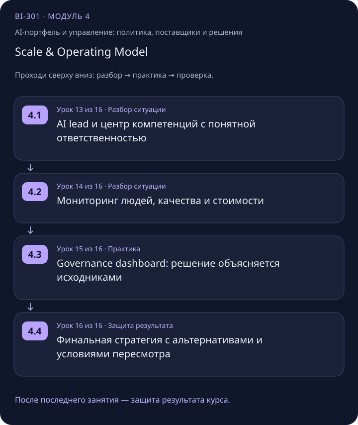
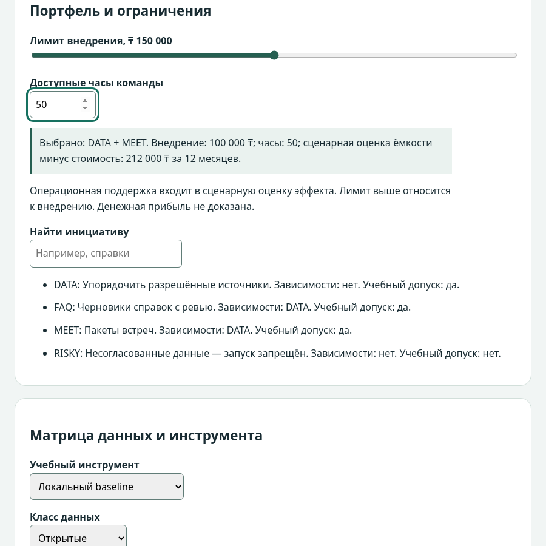

# Модуль 4 из 4 · Scale & Operating Model

[← AI-портфель и управление: политика, поставщики и решения · весь порядок уроков](README.md)

Уроки 13–16 из 16. Проходи их сверху вниз: от 4.1 к 4.4, затем к следующему модулю.

Тексты и практика для просмотра. Зачёт, квизы и прогресс выполняются в мини-аппке после публикации материалов.

## В этом модуле

1. [Урок 13 · 4.1 · AI lead и центр компетенций с понятной ответственностью](#lesson-bi-301-m4-l1)
2. [Урок 14 · 4.2 · Мониторинг людей, качества и стоимости](#lesson-bi-301-m4-l2)
3. [Урок 15 · 4.3 · Governance dashboard: решение объясняется исходниками](#lesson-bi-301-m4-l3)
4. [Урок 16 · 4.4 · Финальная стратегия с альтернативами и условиями пересмотра](#lesson-bi-301-m4-l4)

## Урок 13 из 16 · 4.1 · AI lead и центр компетенций с понятной ответственностью

Код занятия: `BI-301-M4-L1`.

[← Предыдущий урок: Урок 12 · 3.4 · Защита закупочной рекомендации](M3.md#lesson-bi-301-m3-l4)

[Следующий урок →: Урок 14 · 4.2 · Мониторинг людей, качества и стоимости](M4.md#lesson-bi-301-m4-l2)

Центр компетенций полезен, когда помогает командам проверять и поддерживать решения. Название роли не создаёт полномочий на данные, закупку или изменение процесса. Определи границы AI lead, владельца продукта, безопасности, юридической проверки и руководителя процесса.

Составь каталог услуг: разбор сценария, помощь с протоколом пилота, проверка качества, обучение и разбор инцидента. Для каждой услуги укажи вход, результат, срок ответа, владельца и маршрут сложного случая. Не делай централизованную команду единственным проверяющим всех черновиков: оцени пропускную способность и распределённые роли. Используй очередь запросов и критерии приоритета, не обещая постоянной поддержки без людей. Покажи, как знания после инцидента меняют шаблон, тест или обучение, и как команда узнаёт о новой версии.

### Практика

Собери модель работы AI lead/центра компетенций с каталогом услуг и маршрутами ответственности. Сохрани исходные сведения, свою версию и фактическую проверку. Для AI-инструмента укажи, что действительно запускалось, а что осталось планом. Учебные фикстуры обозначай как синтетические и отделяй их от собственных наблюдений.

### Самопроверка

- Услуги связаны с результатом команды
- Полномочия и нагрузка ограничены
- Есть обратная связь в шаблоны и обучение

### Подсказка

Проверь, кто поможет проекту, если AI lead отсутствует две недели.

[Практические файлы](https://github.com/ilyasazelkhanov-hash/elaz-ed/raw/refs/heads/main/public/learning/academy/business-lab.zip). В архиве README, готовые учебные примеры и команды проверки. Используй свою копию и приложи результат с объяснением ограничений. Само скачивание не закрывает задание.

## На примере: AI lead не должен быть единственным исполнителем

Центр компетенций помогает командам получать результат через понятные услуги и границы ответственности, а не забирает все решения себе.

В «Маяке» один AI lead доступен 8 часов в неделю. Владельцы процессов остаются ответственными за свои результаты.

### Что есть в начале

Заявки: проверка источников — 3 ч, обучение работе с рубрикой — 2 ч, разбор инцидента — 4 ч. Всего 9 ч. Право утверждать расходы и условия данных у AI lead не подтверждено.

### Разберём по шагам

1. Оформи три услуги с входом и выходом: реестр источников с замечаниями, проверенная учебная работа, карточка инцидента с дальнейшими действиями.
2. Сравни спрос 9 ч с ёмкостью 8 ч. Приоритет инцидента не убирает конфликт: согласуй перенос части некритичной проверки, обозначив предлагаемый порядок.
3. Сохрани решения о данных и расходах за уполномоченными ролями. Добавь обратную связь: типовая ошибка из разбора обновляет шаблон и упражнение.

### Что должно получиться

Каталог из трёх услуг, очередь с лимитом, маршрут эскалации и одна петля обновления материалов. Нет обещания, что один специалист выполнит всё одновременно.

### Где легко ошибиться

Назвать AI lead владельцем всех решений без полномочий либо принять девять часов работы в восьмичасовую ёмкость.

### Проверка примера

Кому принадлежит итог каждого процесса? Что переносится при перегрузке и как повторяющаяся ошибка меняет обучение?

Пример вымышленный. Он не подтверждает внедрение, фактический AI-вызов или независимое ревью.

## Практика: другие исходные данные

У новой команды 6 часов экспертной поддержки. Заявки: обзор набора данных 2 ч, адаптация шаблона 2 ч, консультация 1 ч, инцидент 3 ч. Создай каталог услуг и очередь, объясни приоритет и перенос, отметь решения вне полномочий AI lead и один способ вернуть выводы в обучение.

### Что нужно сохранить

Собери модель работы AI lead/центра компетенций с каталогом услуг и маршрутами ответственности.

Сохрани входы, свою версию, проверку и ограничения. Подпиши режим: фактический локальный запуск, фактический AI-запуск или анализ готового примера. Отсутствие запуска не считается выполненным запуском.

### Подсказка: исправь причину, а не только ответ

- Если очередь помещается только на словах, сложи оценки и покажи отложенный объём.

- Если эксперт назначен владельцем чужого процесса, отдели консультацию от права принять решение.

### Практика: перенос в новый контекст

Эксперт недоступен неделю. Опиши безопасный маршрут срочного инцидента и какие услуги приостанавливаются без скрытой передачи полномочий.

### Самопроверка: доказательства результата

- Услуги связаны с результатом команды

- Полномочия и нагрузка ограничены

- Есть обратная связь в шаблоны и обучение

Для каждого критерия отметь «нет доказательства», «частично» или «достаточно» и укажи фрагмент своей работы. При пробеле исправь работу и сохрани новую версию с причиной изменения. Это ориентир самопроверки, не автоматический зачёт и не замена действующей рубрики. Проверка работы и статус в Academy выполняются отдельно.

### Результат занятия

Собери модель работы AI lead/центра компетенций с каталогом услуг и маршрутами ответственности.

### Критерии

- Услуги связаны с результатом команды
- Полномочия и нагрузка ограничены
- Есть обратная связь в шаблоны и обучение

### Куда дальше

[← Предыдущий урок: Урок 12 · 3.4 · Защита закупочной рекомендации](M3.md#lesson-bi-301-m3-l4)

[Следующий урок →: Урок 14 · 4.2 · Мониторинг людей, качества и стоимости](M4.md#lesson-bi-301-m4-l2)

## Урок 14 из 16 · 4.2 · Мониторинг людей, качества и стоимости

Код занятия: `BI-301-M4-L2`.

[← Предыдущий урок: Урок 13 · 4.1 · AI lead и центр компетенций с понятной ответственностью](M4.md#lesson-bi-301-m4-l1)

[Следующий урок →: Урок 15 · 4.3 · Governance dashboard: решение объясняется исходниками](M4.md#lesson-bi-301-m4-l3)

Мониторинг нужен для решения, а не накопления показателей. Свяжи качество, полное время, стоимость, обращения и инциденты с владельцем действия. Число активных пользователей без качества и нагрузки ревью может отражать бесполезную работу.

Для каждого показателя задай источник, период, единицу, порог, владельца и следующий шаг. Отдельно помечай задержку обновления и пропуски. Сравни метрики команды и инструмента: ухудшение может быть вызвано новым типом задач, а не только моделью. Не используй учебные проценты для оценки реальных сотрудников. Уважай согласованные условия наблюдения и собирай минимально нужные данные. Порог должен запускать проверку и действие, а не автоматически менять бюджет без полномочий. Периодически проверяй, сам ли мониторинг не стал лишней нагрузкой.

### Практика

Спроектируй мониторинг пяти показателей с источником, качеством данных, владельцем и реакцией. Сохрани исходные сведения, свою версию и фактическую проверку. Для AI-инструмента укажи, что действительно запускалось, а что осталось планом. Учебные фикстуры обозначай как синтетические и отделяй их от собственных наблюдений.

### Самопроверка

- Показатели ведут к действиям
- Пропуски и задержки видны
- Оценка людей не подменена числом запусков

### Подсказка

Удали показатель, если не можешь назвать решение, которое он помогает принять.

[Практические файлы](https://github.com/ilyasazelkhanov-hash/elaz-ed/raw/refs/heads/main/public/learning/academy/business-lab.zip). В архиве README, готовые учебные примеры и команды проверки. Используй свою копию и приложи результат с объяснением ограничений. Само скачивание не закрывает задание.

## На примере: Пять показателей с действием и знаменателем

Мониторинг полезен, если показатель связан с источником, свежестью, неизвестными и действием владельца. Число запусков не измеряет навык человека.

«Маяк» оценивает ограниченный пилот, а не рейтинг сотрудников. Пять сигналов нужны для следующего решения.

### Что есть в начале

Из 20 задач проверены 16, из них 14 приняты; журнал расходов обновлён 2 дня назад при лимите свежести 1 день; время записано у 12 задач; один инцидент открыт; из 6 участников только 3 выполнили новую задачу, результаты двух из этих трёх приняты.

### Разберём по шагам

1. Для качества покажи 14/16 = 87,5% среди проверенных и покрытие 16/20 = 80%. Не подменяй неизвестные четыре задачи успешными.
2. Опиши пять карточек: качество, полная стоимость, время вместе с ревью, открытые инциденты, самостоятельное выполнение новой задачи. Для каждой укажи источник и пробел.
3. Назначь действия: обновить затраты, собрать пропущенное время, проверить оставшиеся работы и закрывать инцидент только по доказательствам. Не ранжируй людей по числу запусков.

### Что должно получиться

Пять карточек с числителем/знаменателем там, где нужен процент, свежестью, владельцем и реакцией. Вывод о навыке относится только к проверенным задачам.

### Где легко ошибиться

Показать 87,5% как качество всех задач или объявить трёх участников некомпетентными из-за отсутствия результатов.

### Проверка примера

Может ли другой читатель восстановить число из источника? Отделены ли «нет наблюдения» и «наблюдался провал»?

Пример вымышленный. Он не подтверждает внедрение, фактический AI-вызов или независимое ревью.

## Практика: другие исходные данные

Новые данные: 30 задач, 18 проверены, 15 приняты; расходы обновлены 3 дня назад; время есть у 20 задач; 2 открытых инцидента; из 8 участников 5 выполнили новую задачу, 4 работы приняты. Создай пять карточек с источником, покрытием, владельцем и действием, не выводя общий рейтинг сотрудников.

### Что нужно сохранить

Спроектируй мониторинг пяти показателей с источником, качеством данных, владельцем и реакцией.

Сохрани входы, свою версию, проверку и ограничения. Подпиши режим: фактический локальный запуск, фактический AI-запуск или анализ готового примера. Отсутствие запуска не считается выполненным запуском.

### Подсказка: исправь причину, а не только ответ

- Если процент качества посчитан из всех 30, отдели успешность среди проверенных от покрытия проверки.

- Если пропуски незаметны, выведи их рядом с показателем, а не в сноску без действия.

### Практика: перенос в новый контекст

Количество запусков выросло вдвое, а покрытие проверки упало. Предложи проверку причин без вывода о росте или падении навыка работников.

### Самопроверка: доказательства результата

- Показатели ведут к действиям

- Пропуски и задержки видны

- Оценка людей не подменена числом запусков

Для каждого критерия отметь «нет доказательства», «частично» или «достаточно» и укажи фрагмент своей работы. При пробеле исправь работу и сохрани новую версию с причиной изменения. Это ориентир самопроверки, не автоматический зачёт и не замена действующей рубрики. Проверка работы и статус в Academy выполняются отдельно.

### Результат занятия

Спроектируй мониторинг пяти показателей с источником, качеством данных, владельцем и реакцией.

### Критерии

- Показатели ведут к действиям
- Пропуски и задержки видны
- Оценка людей не подменена числом запусков

### Куда дальше

[← Предыдущий урок: Урок 13 · 4.1 · AI lead и центр компетенций с понятной ответственностью](M4.md#lesson-bi-301-m4-l1)

[Следующий урок →: Урок 15 · 4.3 · Governance dashboard: решение объясняется исходниками](M4.md#lesson-bi-301-m4-l3)

## Урок 15 из 16 · 4.3 · Governance dashboard: решение объясняется исходниками

Код занятия: `BI-301-M4-L3`.

[← Предыдущий урок: Урок 14 · 4.2 · Мониторинг людей, качества и стоимости](M4.md#lesson-bi-301-m4-l2)

[Следующий урок →: Урок 16 · 4.4 · Финальная стратегия с альтернативами и условиями пересмотра](M4.md#lesson-bi-301-m4-l4)

Скриншот после изменения часов в синтетическом портфеле. Сопоставь выбор с зависимостями и лимитом внедрения; бюджет не утверждается.

Учебная панель связывает показатели пилота, портфель и правило данных. Открой index.html через HTTP-сервер по README. Восемь синтетических задач дают качество 75%, поэтому локальный порог требует доработки, несмотря на сокращение времени.

Измени бюджет и доступные часы по одному параметру. При 150000 ₸ и 70 часах выбираются DATA+FAQ; при 50 часах — DATA+MEET. Проверь источник выбора в portfolio.json и ограничения в choosePortfolio. Затем выбери внешний инструмент и внутренние данные: локальная декларация отклонит сочетание. Это демонстрация расчёта и правила, а не рабочий реестр прав или утверждение расходов. Найди ограничение панели: она не знает фактических инцидентов компании и не измеряет причинный эффект. Для собственного dashboard добавь происхождение, актуальность и маршрут действия по каждой карточке.

### Практика

Покажи три изменения в панели и объясни решения через исходные данные и ограничения. Сохрани исходные сведения, свою версию и фактическую проверку. Для AI-инструмента укажи, что действительно запускалось, а что осталось планом. Учебные фикстуры обозначай как синтетические и отделяй их от собственных наблюдений.

### Самопроверка

- Изменения действительно выполнены
- Результат прослеживается до правила
- Панель не выдана за production-управление

### Подсказка

Сделай скриншот до и после изменения одного ограничения и подпиши причину смены выбора.

[Практические файлы](https://github.com/ilyasazelkhanov-hash/elaz-ed/raw/refs/heads/main/public/learning/academy/business-lab.zip). В архиве README, готовые учебные примеры и команды проверки. Используй свою копию и приложи результат с объяснением ограничений. Само скачивание не закрывает задание.

## На примере: Панель: три изменения, три объяснения

Изменение показателя объясняется исходными данными и правилом; внешний вид панели не подтверждает полноту наблюдений.

Открой локальную учебную панель business-lab по README. Этот пример использует именно файлы архива, а не мини-наборы предыдущих уроков.

### Что есть в начале

В portfolio.json: DATA 40000 ₸/20 ч; FAQ 80000 ₸/40 ч; MEET 60000 ₸/30 ч. При бюджете 150000 ₸ и 70 ч выбирается DATA+FAQ. pilot.csv содержит 8 пар с качеством 6/8. policy.json допускает external_demo только для public summary.

### Разберём по шагам

1. Зафиксируй исходный выбор, затем уменьши часы до 50: DATA+FAQ требует 60 ч и исключается, DATA+MEET требует 50 ч и остаётся.
2. Верни 70 ч и уменьши бюджет до 90000 ₸: ни FAQ с DATA, ни MEET с DATA не помещаются. Найди фактический новый выбор панели и проверь его по portfolio.json.
3. Верни бюджет 150000 ₸ и выбери external_demo с internal: локальное правило должно отклонить сочетание. Сохрани состояние и причину; качество 6/8 остаётся ограничением независимо от бюджетного выбора.

### Что должно получиться

Три записи «до → изменённый параметр → фактический результат → строка данных/правило». Скриншоты подтверждают только локальную демонстрацию; без запуска остаётся анализ ожидаемого поведения.

### Где легко ошибиться

Подставить числа из мини-примера 30000/50000 ₸ в реальную панель либо менять несколько параметров и приписывать результат одному.

### Проверка примера

Для каждого изменения найди источник и формулу. Подпиши, какие действия реально выполнены и что осталось прогнозом.

Пример вымышленный. Он не подтверждает внедрение, фактический AI-вызов или независимое ревью.

## Практика: другие исходные данные

На своей учебной копии начни с 150000 ₸/70 ч. По одному проверь лимит 55 ч, затем 70000 ₸ при восстановленных 70 ч, затем неизвестный инструмент в локальной policy-проверке. Сохрани три наблюдения, версии входов и причины. Если запуск недоступен, представь таблицу ожидаемого поведения с пометкой «не запускалось», не скриншот чужой работы.

### Что нужно сохранить

Покажи три изменения в панели и объясни решения через исходные данные и ограничения.

Сохрани входы, свою версию, проверку и ограничения. Подпиши режим: фактический локальный запуск, фактический AI-запуск или анализ готового примера. Отсутствие запуска не считается выполненным запуском.

### Подсказка: исправь причину, а не только ответ

- Если результат не совпал, сначала проверь исходные лимиты и файл, а не исправляй ответ по памяти.

- Если говорится «доступ защищён», замени на точное описание локальной проверки и перечисли непроверенные серверные ограничения.

### Практика: перенос в новый контекст

В панель добавлен новый источник расходов с задержкой. Определи, где показать свежесть и какое управленческое действие нельзя выполнять по старым данным.

### Самопроверка: доказательства результата

- Изменения действительно выполнены

- Результат прослеживается до правила

- Панель не выдана за production-управление

Для каждого критерия отметь «нет доказательства», «частично» или «достаточно» и укажи фрагмент своей работы. При пробеле исправь работу и сохрани новую версию с причиной изменения. Это ориентир самопроверки, не автоматический зачёт и не замена действующей рубрики. Проверка работы и статус в Academy выполняются отдельно.

### Результат занятия

Покажи три изменения в панели и объясни решения через исходные данные и ограничения.

### Критерии

- Изменения действительно выполнены
- Результат прослеживается до правила
- Панель не выдана за production-управление

### Куда дальше

[← Предыдущий урок: Урок 14 · 4.2 · Мониторинг людей, качества и стоимости](M4.md#lesson-bi-301-m4-l2)

[Следующий урок →: Урок 16 · 4.4 · Финальная стратегия с альтернативами и условиями пересмотра](M4.md#lesson-bi-301-m4-l4)

## Урок 16 из 16 · 4.4 · Финальная стратегия с альтернативами и условиями пересмотра

Код занятия: `BI-301-M4-L4`.

[← Предыдущий урок: Урок 15 · 4.3 · Governance dashboard: решение объясняется исходниками](M4.md#lesson-bi-301-m4-l3)

Это последний урок курса. Проверь итоговую работу по критериям; чтение страницы само по себе не даёт зачёт.

Стратегия объединяет цель организации, аудит, портфель, правила, людей и экономику. Она должна объяснять, какие решения принимаются сейчас, какие отложены до проверки и почему. Красивый план без владельцев и ограничений не помогает действовать.

Защити пакет: основания аудита, карта зависимостей, ограниченный портфель, дорожная карта, политика данных, инцидент, vendor/TCO, обучение и мониторинг. Отдельно представь ручную альтернативу и сценарий меньших ресурсов. Для каждого существенного допущения назови способ проверки и триггер пересмотра. Если проект основан на синтетическом архиве, вывод касается качества метода, а не реальной зрелости или прибыли компании. Покажи собственный вклад и фактические проверки, не приписывая согласование комитету. Заверши конкретным ограниченным следующим шагом, его владельцем и условием остановки.

### Практика

Защити стратегический пакет с альтернативами, доказательствами, ограничениями и планом следующего этапа. Сохрани исходные сведения, свою версию и фактическую проверку. Для AI-инструмента укажи, что действительно запускалось, а что осталось планом. Учебные фикстуры обозначай как синтетические и отделяй их от собственных наблюдений.

### Самопроверка

- Стратегия связывает все части пакета
- Факты и допущения разделены
- Решения имеют владельцев и пересмотр

### Подсказка

Представь, что бюджет уменьшился вдвое: какие части стратегии сохранят пользу и что следует отложить?

[Практические файлы](https://github.com/ilyasazelkhanov-hash/elaz-ed/raw/refs/heads/main/public/learning/academy/business-lab.zip). В архиве README, готовые учебные примеры и команды проверки. Используй свою копию и приложи результат с объяснением ограничений. Само скачивание не закрывает задание.

## На примере: Итоговый проект: стратегия выдерживает новый факт

Стратегия объединяет доказательства, ограничения, людей и экономику. Перенос навыка проверяется изменением условий без готового пошагового ответа.

«Маяк» собирает учебный стратегический пакет и получает новое ограничение перед защитой. Это не реальный аудит компании.

### Что есть в начале

Аудит выявил неизвестные часы поддержки; портфель требует DATA; условия внешнего сервиса не проверены; выход неполон; доступно 30 часов команды, из них 6 для проверки. В новом сообщении бюджет сокращён вдвое, а владелец данных не назначен.

### Разберём по шагам

1. Свяжи ключевое решение со свидетельством и допущением: внешний запуск нельзя рекомендовать, пока условия данных не проверены.
2. Покажи альтернативы: ограниченная работа на синтетике и ручной путь. Сокращение бюджета не разрешает убрать обязательную проверку.
3. Назови предлагаемый следующий шаг, роль владельца, предел затрат как план, критерий остановки и дату следующего обзора. Не заявляй реальное согласование или независимую проверку.

### Что должно получиться

Короткая стратегия с приложениями: аудит, зависимости/лимиты, политика/инцидент, vendor/TCO/выход, роли и мониторинг. Новый факт меняет решение явно, а не прячется в конце документа.

### Где легко ошибиться

Соединить красивые разделы без связи решения с доказательствами или выдать учебную защиту за подтверждённое внедрение.

### Проверка примера

У каждого решения есть основание, неизвестное, владелец и триггер пересмотра? Отличимы ли собственная работа, образец и фактическая проверка?

Пример вымышленный. Он не подтверждает внедрение, фактический AI-вызов или независимое ревью.

## Практика: контрольная работа

Итоговая работа: используй собственные результаты трёх контрольных практик и модуль 4. Подготовь стратегический пакет и одностраничную записку решения. Добавь самостоятельный новый контекст: вымышленный учебный центр с 24 часами команды, бюджетом 60000 ₸, публичными расписаниями и внутренними заявками. Выбери ограниченный сценарий, задай и подпиши собственные допущения, объясни ручную альтернативу и условия остановки. Никаких реальных персональных данных.

### Что нужно сохранить

Защити стратегический пакет с альтернативами, доказательствами, ограничениями и планом следующего этапа.

Сохрани входы, свою версию, проверку и ограничения. Подпиши режим: фактический локальный запуск, фактический AI-запуск или анализ готового примера. Отсутствие запуска не считается выполненным запуском.

### Подсказка: исправь причину, а не только ответ

- Если вывод невозможно проследить до приложения, добавь ID свидетельства и объяснение связи.

- Если все проверки обозначены успешными, отдели выполненные наблюдения, локальные тесты, ожидаемые результаты и ещё не проверенные условия.

### Практика: перенос в новый контекст

На защите получи новый факт: половина источников устарела, а срок пилота не изменился. Без готового шаблона объясни, какие решения сохраняются, какие приостанавливаются и какое свидетельство нужно первым.

### Самопроверка: доказательства результата

- Стратегия связывает все части пакета

- Факты и допущения разделены

- Решения имеют владельцев и пересмотр

Для каждого критерия отметь «нет доказательства», «частично» или «достаточно» и укажи фрагмент своей работы. При пробеле исправь работу и сохрани новую версию с причиной изменения. Это ориентир самопроверки, не автоматический зачёт и не замена действующей рубрики. Проверка работы и статус в Academy выполняются отдельно.

### Результат занятия

Защити стратегический пакет с альтернативами, доказательствами, ограничениями и планом следующего этапа.

### Критерии

- Стратегия связывает все части пакета
- Факты и допущения разделены
- Решения имеют владельцев и пересмотр

### Куда дальше

[← Предыдущий урок: Урок 15 · 4.3 · Governance dashboard: решение объясняется исходниками](M4.md#lesson-bi-301-m4-l3)

Это последний урок курса. Проверь итоговую работу по критериям; чтение страницы само по себе не даёт зачёт.

## Проверенные источники

- [OWASP: GenAI application risks](https://github.com/OWASP/www-project-top-10-for-large-language-model-applications) · проверено 2026-10-27
- [W3C TAG: Privacy Principles](https://github.com/w3ctag/privacy-principles) · проверено 2026-10-27

## Переход между модулями

[← Модуль 3: Vendor & TCO](M3.md)

Это последний модуль. Вернись к критериям итоговой работы и проверь результат.
