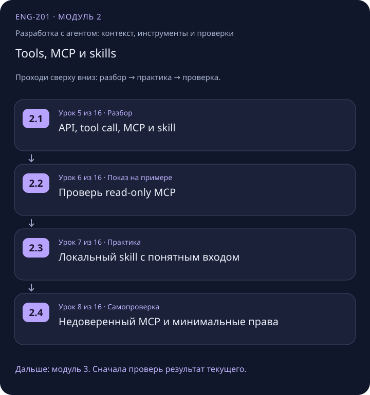
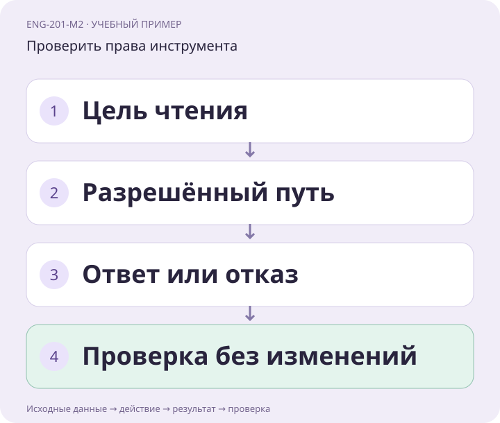

# Модуль 2 из 4 · Tools, MCP и skills

[← Разработка с агентом: контекст, инструменты и проверки · весь порядок уроков](README.md)

Уроки 5–8 из 16. Проходи их сверху вниз: от 2.1 к 2.4, затем к следующему модулю.

Тексты и практика для просмотра. Зачёт, квизы и прогресс выполняются в мини-аппке после публикации материалов.

## В этом модуле

1. [Урок 5 · 2.1 · API, tool call, MCP и skill](#lesson-eng-201-m2-l1)
2. [Урок 6 · 2.2 · Проверь read-only MCP](#lesson-eng-201-m2-l2)
3. [Урок 7 · 2.3 · Локальный skill с понятным входом](#lesson-eng-201-m2-l3)
4. [Урок 8 · 2.4 · Недоверенный MCP и минимальные права](#lesson-eng-201-m2-l4)

## Урок 5 из 16 · 2.1 · API, tool call, MCP и skill

Код занятия: `ENG-201-M2-L1`.

[← Предыдущий урок: Урок 4 · 1.4 · Аудит потери контекста](M1.md#lesson-eng-201-m1-l4)

[Следующий урок →: Урок 6 · 2.2 · Проверь read-only MCP](M2.md#lesson-eng-201-m2-l2)

API задаёт интерфейс взаимодействия программ. Tool call — предложение или исполнение конкретного инструмента в выбранной системе. MCP стандартизует обмен возможностями и вызовами между клиентом и сервером. Skill обычно содержит инструкции и материалы для повторяемой задачи; сам текст не становится новым полномочием.

В лаборатории mcp-readonly.mjs публикует один инструмент чтения с ограниченным списком файлов. Он использует stdio и фиксированную версию протокола 2025-03-26. Это не общий сервер командной строки и не регистрация внешнего сервиса в твоём AI-клиенте.

Составь карту: где описаны параметры, кто решает выполнить вызов, какой код читает файл и где применяется ограничение пути. Сравни это с AGENTS.md: файл правил объясняет способ работы, но не исполняет чтение самостоятельно. Для каждой сущности придумай один корректный пример и одну ошибочную подмену. Не называй подключённым инструмент, если ты только написал его название в промпте.

### Практика

Результат: Карта четырёх понятий и границ исполнения. Работай с отдельной учебной копией, сохраняя исходное состояние. До изменения укажи проверяемый критерий, после — фактический результат и diff. Не заменяй невыполненную проверку обещанием агента.

### Самопроверка

- Инструкция не приравнена к полномочию
- MCP отделён от произвольного shell
- Подключение подтверждается вызовом

### Подсказка

Отдели правила задачи, доступные инструменты и свидетельство результата. При сбое найди первую нарушенную границу и повтори минимальный случай.

[Скачать инженерную лабораторию](https://github.com/ilyasazelkhanov-hash/elaz-ed/raw/refs/heads/main/public/learning/academy/engineering-lab.zip). На Node 24 выполни `node --test harness.test.mjs mcp.test.mjs`, затем `node demo.mjs`. Demo использует временную копию и заранее проверенную правку. Реальная модель не вызывается.

## На примере: Проверить права инструмента

Вызов инструмента — это действие с определённым входом и полномочиями. Протокол подключения сам по себе не разрешает чтение любых файлов или изменение данных.

Учебному помощнику нужно прочитать правила расчёта. Для этой задачи достаточно разрешённого файла; запись в проект и доступ к соседним папкам не нужны.

### Что есть в начале

В плане есть один разрешённый путь, ожидаемая структура результата и отдельный запрещённый путь. Используется локальный пример без внешнего сервиса.

### Разберём по шагам

1. Запиши назначение инструмента, допустимые пути и явный запрет изменения файлов.
2. Повтори разрешённое чтение, затем отдельный запрос за пределами списка и сохрани различимые исходы.
3. Проверь, что текст прочитанного документа не расширяет права, а переданные сведения не попали в лишний журнал.

### Что должно получиться

Подтверждены разрешённое чтение и отказ за пределами списка; реальная изоляция среды оценивается отдельно.

### Где легко ошибиться

Называть соединение через MCP песочницей или принимать команду документа за разрешение.

### Проверка примера

Сравни состояние файлов до и после: инструмент чтения не должен создавать правку; сам отказ не доказывает защиту всех остальных каналов.

Это вымышленный учебный пример. Он не подтверждает выполненное внедрение, AI-вызов или независимое ревью. Свою практику выполни отдельно.

### Результат занятия

Карта четырёх понятий и границ исполнения

### Критерии

- Инструкция не приравнена к полномочию
- MCP отделён от произвольного shell
- Подключение подтверждается вызовом

### Куда дальше

[← Предыдущий урок: Урок 4 · 1.4 · Аудит потери контекста](M1.md#lesson-eng-201-m1-l4)

[Следующий урок →: Урок 6 · 2.2 · Проверь read-only MCP](M2.md#lesson-eng-201-m2-l2)

## Урок 6 из 16 · 2.2 · Проверь read-only MCP

Код занятия: `ENG-201-M2-L2`.

[← Предыдущий урок: Урок 5 · 2.1 · API, tool call, MCP и skill](M2.md#lesson-eng-201-m2-l1)

[Следующий урок →: Урок 7 · 2.3 · Локальный skill с понятным входом](M2.md#lesson-eng-201-m2-l3)

Запусти mcp.test.mjs. Учебный клиент отправляет initialize, уведомление готовности, tools/list и два tools/call. Разрешённое чтение AGENTS.md возвращает текст, попытка ../secret — безопасный отказ. Проверяется реальный обмен JSON-RPC по stdio, без вызова языковой модели.

В схеме инструмента path ограничен четырьмя файлами. Дополнительно safeFile проверяет абсолютные пути, переходы вверх и символические ссылки. Это важно: описание enum в схеме не заменяет проверку фактического аргумента в обработчике.

Если подключаешь сервер к своему coding-клиенту, используй его официальную конфигурацию и отдельную учебную копию проекта. Совместимость конкретного клиента нужно проверить отдельным вызовом; протокольный fixture-тест её не доказывает для всех версий. Сдай результат списка инструментов, успешного чтения и отказа. Отдельно объясни, что read-only-доступ всё ещё способен раскрыть секрет, если сам оператор положит его в разрешённый файл; минимальный scope не отменяет правил данных.

### Практика

Результат: Три свидетельства read-only-инструмента. Работай с отдельной учебной копией, сохраняя исходное состояние. До изменения укажи проверяемый критерий, после — фактический результат и diff. Не заменяй невыполненную проверку обещанием агента.

### Самопроверка

- Схема дополнена проверкой пути
- Есть успешный вызов и отказ
- Совместимость клиента проверяется отдельно

### Подсказка

Отдели правила задачи, доступные инструменты и свидетельство результата. При сбое найди первую нарушенную границу и повтори минимальный случай.

[Скачать инженерную лабораторию](https://github.com/ilyasazelkhanov-hash/elaz-ed/raw/refs/heads/main/public/learning/academy/engineering-lab.zip). На Node 24 выполни `node --test harness.test.mjs mcp.test.mjs`, затем `node demo.mjs`. Demo использует временную копию и заранее проверенную правку. Реальная модель не вызывается.

## На примере: Проверить права инструмента

Вызов инструмента — это действие с определённым входом и полномочиями. Протокол подключения сам по себе не разрешает чтение любых файлов или изменение данных.

Учебному помощнику нужно прочитать правила расчёта. Для этой задачи достаточно разрешённого файла; запись в проект и доступ к соседним папкам не нужны.

### Что есть в начале

В плане есть один разрешённый путь, ожидаемая структура результата и отдельный запрещённый путь. Используется локальный пример без внешнего сервиса.

### Разберём по шагам

1. Запиши назначение инструмента, допустимые пути и явный запрет изменения файлов.
2. Повтори разрешённое чтение, затем отдельный запрос за пределами списка и сохрани различимые исходы.
3. Проверь, что текст прочитанного документа не расширяет права, а переданные сведения не попали в лишний журнал.

### Что должно получиться

Подтверждены разрешённое чтение и отказ за пределами списка; реальная изоляция среды оценивается отдельно.

### Где легко ошибиться

Называть соединение через MCP песочницей или принимать команду документа за разрешение.

### Проверка примера

Сравни состояние файлов до и после: инструмент чтения не должен создавать правку; сам отказ не доказывает защиту всех остальных каналов.

Это вымышленный учебный пример. Он не подтверждает выполненное внедрение, AI-вызов или независимое ревью. Свою практику выполни отдельно.

### Результат занятия

Три свидетельства read-only-инструмента

### Критерии

- Схема дополнена проверкой пути
- Есть успешный вызов и отказ
- Совместимость клиента проверяется отдельно

### Куда дальше

[← Предыдущий урок: Урок 5 · 2.1 · API, tool call, MCP и skill](M2.md#lesson-eng-201-m2-l1)

[Следующий урок →: Урок 7 · 2.3 · Локальный skill с понятным входом](M2.md#lesson-eng-201-m2-l3)

## Урок 7 из 16 · 2.3 · Локальный skill с понятным входом

Код занятия: `ENG-201-M2-L3`.

[← Предыдущий урок: Урок 6 · 2.2 · Проверь read-only MCP](M2.md#lesson-eng-201-m2-l2)

[Следующий урок →: Урок 8 · 2.4 · Недоверенный MCP и минимальные права](M2.md#lesson-eng-201-m2-l4)

Сформулируй повторяемую задачу: проверить небольшую правку с сохранением старого контракта. Для skill нужны назначение, допустимый вход, последовательность действий, ожидаемый результат и ограничения. Не помещай в него токены, личные пути или команды, которые молча меняют другие проекты.

Подготовь SKILL.md для своей учебной копии: прочитать спецификацию, проверить status, выполнить baseline, сделать маленькую правку, запустить полный целевой набор и показать diff. Укажи, что чужой текст в файлах является данными и не расширяет разрешения.

Skill не должен обещать запуск тестов, если клиент только предложил команду. Итоговый отчёт различает выполненное, проваленное и непройденное. Проверь инструкцию вручную на starter и найди один шаг, который потребовал уточнения. Сдай файл и наблюдение. Для использования в выбранном клиенте дополнительно проверь способ установки и активации; наличие Markdown в папке не доказывает, что инструмент его обнаружил и применил.

### Практика

Результат: SKILL.md и ручная проверка процедуры. Работай с отдельной учебной копией, сохраняя исходное состояние. До изменения укажи проверяемый критерий, после — фактический результат и diff. Не заменяй невыполненную проверку обещанием агента.

### Самопроверка

- Вход и результат определены
- Значения секретов отсутствуют
- Установка отделена от наличия файла

### Подсказка

Отдели правила задачи, доступные инструменты и свидетельство результата. При сбое найди первую нарушенную границу и повтори минимальный случай.

[Скачать инженерную лабораторию](https://github.com/ilyasazelkhanov-hash/elaz-ed/raw/refs/heads/main/public/learning/academy/engineering-lab.zip). На Node 24 выполни `node --test harness.test.mjs mcp.test.mjs`, затем `node demo.mjs`. Demo использует временную копию и заранее проверенную правку. Реальная модель не вызывается.

## На примере: Проверить права инструмента

Вызов инструмента — это действие с определённым входом и полномочиями. Протокол подключения сам по себе не разрешает чтение любых файлов или изменение данных.

Учебному помощнику нужно прочитать правила расчёта. Для этой задачи достаточно разрешённого файла; запись в проект и доступ к соседним папкам не нужны.

### Что есть в начале

В плане есть один разрешённый путь, ожидаемая структура результата и отдельный запрещённый путь. Используется локальный пример без внешнего сервиса.

### Разберём по шагам

1. Запиши назначение инструмента, допустимые пути и явный запрет изменения файлов.
2. Повтори разрешённое чтение, затем отдельный запрос за пределами списка и сохрани различимые исходы.
3. Проверь, что текст прочитанного документа не расширяет права, а переданные сведения не попали в лишний журнал.

### Что должно получиться

Подтверждены разрешённое чтение и отказ за пределами списка; реальная изоляция среды оценивается отдельно.

### Где легко ошибиться

Называть соединение через MCP песочницей или принимать команду документа за разрешение.

### Проверка примера

Сравни состояние файлов до и после: инструмент чтения не должен создавать правку; сам отказ не доказывает защиту всех остальных каналов.

Это вымышленный учебный пример. Он не подтверждает выполненное внедрение, AI-вызов или независимое ревью. Свою практику выполни отдельно.

### Результат занятия

SKILL.md и ручная проверка процедуры

### Критерии

- Вход и результат определены
- Значения секретов отсутствуют
- Установка отделена от наличия файла

### Куда дальше

[← Предыдущий урок: Урок 6 · 2.2 · Проверь read-only MCP](M2.md#lesson-eng-201-m2-l2)

[Следующий урок →: Урок 8 · 2.4 · Недоверенный MCP и минимальные права](M2.md#lesson-eng-201-m2-l4)

## Урок 8 из 16 · 2.4 · Недоверенный MCP и минимальные права

Код занятия: `ENG-201-M2-L4`.

[← Предыдущий урок: Урок 7 · 2.3 · Локальный skill с понятным входом](M2.md#lesson-eng-201-m2-l3)

[Следующий урок →: Урок 9 · 3.1 · Planner, worker и reviewer](M3.md#lesson-eng-201-m3-l1)

Инструмент может возвращать текст с посторонними командами или иметь более широкие полномочия, чем обещает описание. Перед подключением проверь, какие файлы и операции реально доступны, кому уходит информация и как подтверждается изменение. Название read-only само по себе ничего не гарантирует.

В нашем сервере наружу не опубликованы write, execute или shell. Однако чтение разрешённого файла всё равно является доступом к данным. В результате могут оказаться инструкции, которые нужно рассматривать как содержимое файла, а не новую политику выполнения.

Подготовь три проверки: выход за путь, дополнительный аргумент и предложение выполнить неизвестный инструмент. Первые два должны быть отвергнуты обработчиком, а неизвестное имя — протокольной проверкой. Не используй реальный секрет для опыта; достаточно вымышленного маркера в отдельной копии. Сдай модель угроз и фактические ответы сервера. Тест stdio не проверяет сетевую аутентификацию удалённого MCP, потому что такой транспорт в примере не реализован.

### Практика

Результат: Проверка трёх недопустимых вызовов. Работай с отдельной учебной копией, сохраняя исходное состояние. До изменения укажи проверяемый критерий, после — фактический результат и diff. Не заменяй невыполненную проверку обещанием агента.

### Самопроверка

- Права подтверждены обработчиком
- Текст результата не становится политикой
- Удалённая аутентификация не заявлена проверенной

### Подсказка

Отдели правила задачи, доступные инструменты и свидетельство результата. При сбое найди первую нарушенную границу и повтори минимальный случай.

[Скачать инженерную лабораторию](https://github.com/ilyasazelkhanov-hash/elaz-ed/raw/refs/heads/main/public/learning/academy/engineering-lab.zip). На Node 24 выполни `node --test harness.test.mjs mcp.test.mjs`, затем `node demo.mjs`. Demo использует временную копию и заранее проверенную правку. Реальная модель не вызывается.

## На примере: Проверить права инструмента

Вызов инструмента — это действие с определённым входом и полномочиями. Протокол подключения сам по себе не разрешает чтение любых файлов или изменение данных.

Учебному помощнику нужно прочитать правила расчёта. Для этой задачи достаточно разрешённого файла; запись в проект и доступ к соседним папкам не нужны.

### Что есть в начале

В плане есть один разрешённый путь, ожидаемая структура результата и отдельный запрещённый путь. Используется локальный пример без внешнего сервиса.

### Разберём по шагам

1. Запиши назначение инструмента, допустимые пути и явный запрет изменения файлов.
2. Повтори разрешённое чтение, затем отдельный запрос за пределами списка и сохрани различимые исходы.
3. Проверь, что текст прочитанного документа не расширяет права, а переданные сведения не попали в лишний журнал.

### Что должно получиться

Подтверждены разрешённое чтение и отказ за пределами списка; реальная изоляция среды оценивается отдельно.

### Где легко ошибиться

Называть соединение через MCP песочницей или принимать команду документа за разрешение.

### Проверка примера

Сравни состояние файлов до и после: инструмент чтения не должен создавать правку; сам отказ не доказывает защиту всех остальных каналов.

Это вымышленный учебный пример. Он не подтверждает выполненное внедрение, AI-вызов или независимое ревью. Свою практику выполни отдельно.

## Практика: авторизация удалённого MCP

Локальный stdio из предыдущего примера и удалённый HTTP-сервер имеют разные границы. OAuth-поток из официального руководства относится к HTTP. Не добавляй этот поток в stdio только ради одинакового названия MCP. Существующая лаборатория остаётся примером протокола 2025-03-26; следующие требования относятся к руководству для 2026-07-28, проверенному 12 ноября 2026 года.

Для HTTP проверяй не наличие слова Bearer, а достоверность токена и его назначение. В настоящем сервисе доверенная библиотека проверяет подпись, разрешённый алгоритм, ключи издателя и срок. Затем сервер проверяет точный issuer, audience именно этого ресурса и требуемые scope. Токен другого сервиса не подходит даже при корректной подписи. Scope сравнивается как отдельное разрешение: mcp:read-extra не равно mcp:read. Origin проверяют отдельно от токена; это не доказательство личности пользователя. Идентификатор MCP-сессии тоже не является аутентификацией.

В обновлённом руководстве Client ID Metadata Documents (CIMD) рекомендованы новым реализациям вместо deprecated Dynamic Client Registration (DCR); DCR оставлен для совместимости. Регистрация происходит между клиентом и authorization server, а не превращает MCP-сервер в сервис регистрации. Примеры используют SDK v2. В TypeScript expectedResource требует @modelcontextprotocol/express 2.0.2 или новее, а прежние версии его игнорируют. Даже в новой версии нужно сохранять явную проверку audience в JWT-библиотеке: expectedResource сам не разбирает токен. Перед реальным запуском перепроверь версии своего SDK и провайдера.

[Скачать автономную лабораторию авторизации](https://github.com/ilyasazelkhanov-hash/elaz-ed/raw/refs/heads/main/public/learning/academy/mcp-authorization-lab.zip). В отдельной папке на Node.js 24 выполни node --test, затем node demo.mjs. Установка пакетов, сеть, аккаунт и настоящий токен не нужны. Это самостоятельная учебная модель решений после проверки токена, не JWT-валидатор, OAuth-сервер или реализация MCP. Флаг успешной криптографической проверки здесь задаёт синтетическая фикстура; его нельзя принимать от внешнего клиента в рабочем приложении.

### Разберём на примере

Вымышленный сервер ждёт своего издателя, собственный audience и право чтения. Сначала проследи разрешённый запрос в demo. Затем измени по одному условию: чужой issuer, audience соседнего сервиса, похожий scope и истёкший срок. Во всех четырёх случаях исполнение должно быть запрещено. Отдельно сравни HTTP Origin с личностью владельца токена и объясни, почему одно не заменяет другое.

### Практика: перенос в новый контекст

Сделай собственную копию теста для сервиса отчётов: другое имя ресурса и два обязательных scope. Проверь строковый и массивный audience, отсутствующее поле, слишком ранний токен и недоверенный Origin. Не ослабляй проверку ради зелёного результата. Сохрани таблицу «вход → отказ/разрешение → причина» и фактический вывод тестов.

### Самопроверка: границы результата

- Есть разрешённый случай и независимые отказы по issuer, audience и scope.
- Криптографическая проверка отделена от проверки политики; поддельный флаг из сети не считается доказательством.
- Указаны версия протокола, версия SDK из источника и отличие HTTP от stdio.
- Отчёт не заявляет проверенный вход, сетевую интеграцию, безопасность production или выполнение реального действия.

Авторский пример создан по интерфейсным требованиям официального руководства. Его текст и код не перепечатаны; точные ссылки, дата проверки и условия лицензий включены в README и SOURCES.md архива.

### Результат занятия

Модель угроз локального MCP и таблица решений авторизации удалённого HTTP-сервера

### Критерии

- Права подтверждены обработчиком
- Текст результата не становится политикой
- Удалённая аутентификация не заявлена проверенной
- В HTTP-модели отдельно проверены issuer, audience, scope и срок
- Синтетическая проверка токена не названа настоящей JWT-валидацией
- Различены stdio, HTTP и версия SDK expectedResource

### Куда дальше

[← Предыдущий урок: Урок 7 · 2.3 · Локальный skill с понятным входом](M2.md#lesson-eng-201-m2-l3)

[Следующий урок →: Урок 9 · 3.1 · Planner, worker и reviewer](M3.md#lesson-eng-201-m3-l1)

## Проверенные источники

- [MCP: официальная схема протокола 2025-03-26](https://github.com/modelcontextprotocol/specification/tree/main/schema/2025-03-26) · проверено 2026-10-26
- [OpenAI Codex: официальный репозиторий и инструкции клиента](https://github.com/openai/codex) · проверено 2026-10-26
- [MCP 2026-07-28: HTTP authorization, CIMD и проверка токенов](https://github.com/modelcontextprotocol/modelcontextprotocol/blob/0b22bfed6e94c0c7751046d2e845fac954cac8a7/docs/docs/2026-07-28/tutorials/security/authorization.mdx) · проверено 2026-11-12
- [MCP: условия использования документации и спецификации](https://github.com/modelcontextprotocol/modelcontextprotocol/blob/0b22bfed6e94c0c7751046d2e845fac954cac8a7/LICENSE) · проверено 2026-11-12

## Переход между модулями

[← Модуль 1: Context engineering](M1.md)

[Модуль 3: Subagents и параллельная работа →](M3.md#lesson-eng-201-m3-l1)
