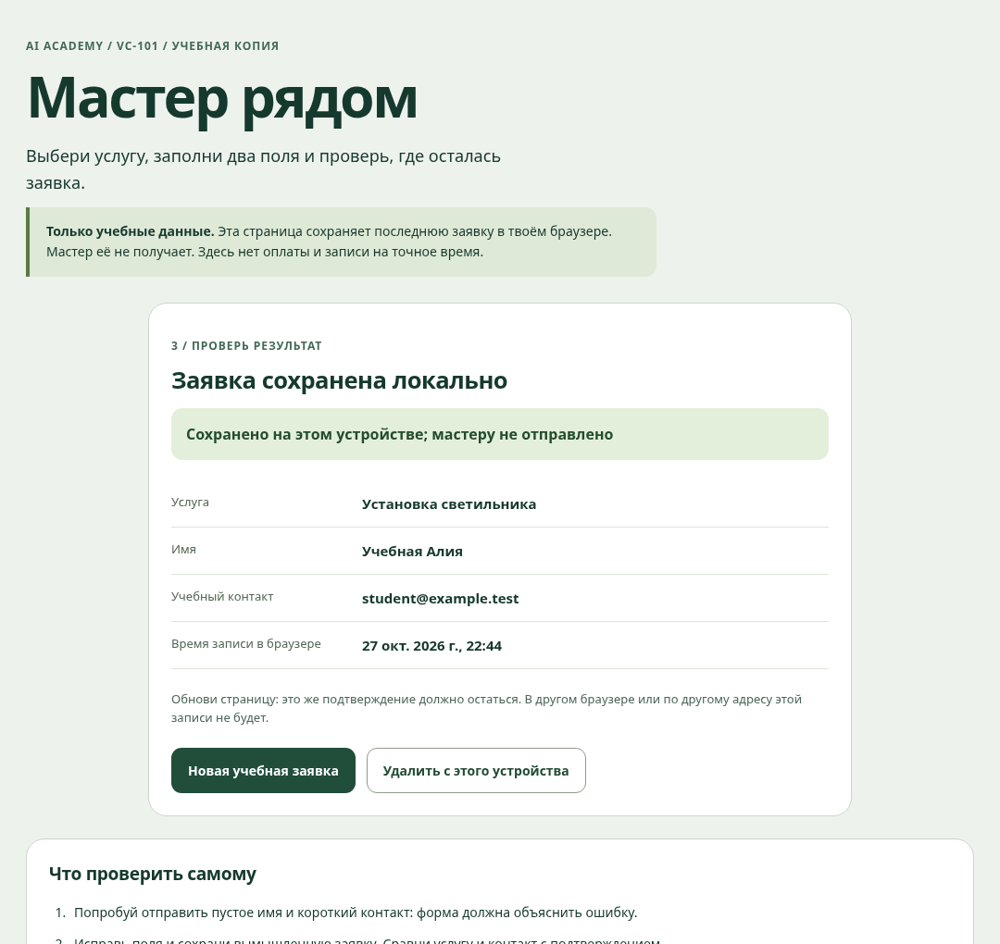
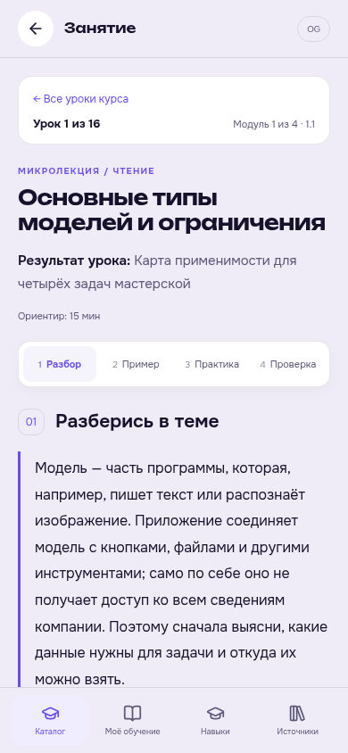
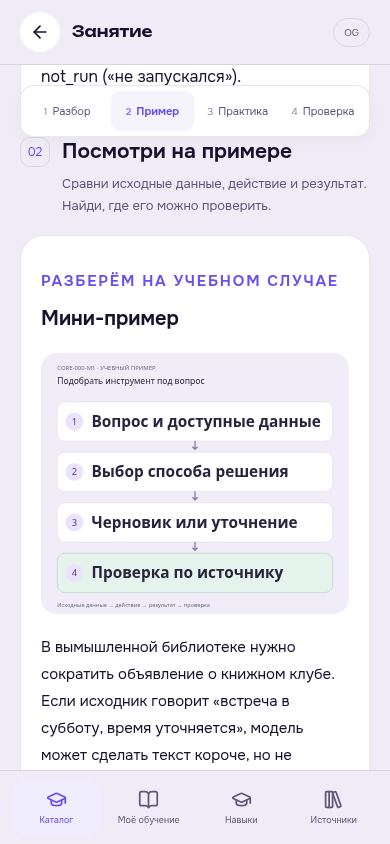
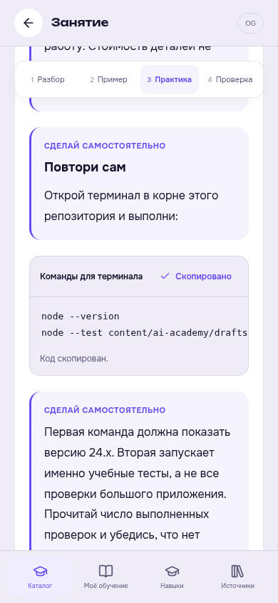

# С чего начать: AI Core и первое приложение

В [CORE-000](courses/CORE-000/README.md) и [VC-101](courses/VC-101/README.md) у каждого из 32 занятий теперь есть простое объяснение, отдельный маленький пример, три действия, наблюдаемый результат, типичная ошибка и вопросы для самопроверки. Примеры отличаются от оцениваемой итоговой работы.

## AI Core: тетрадь без установки

[Скачать рабочую тетрадь](https://raw.githubusercontent.com/ilyasazelkhanov-hash/elaz-ed/main/public/learning/academy/core-workbook.zip) · [читать инструкцию](../../content/ai-academy/projects/core-workbook/README.md).

Распакуй архив и открой README.md в текстовом редакторе. Начни с M1-basics.md. Внутри четыре листа по модулям, вымышленные разрешённые документы, каркас запроса, журнал запусков, сравнение, проверка источников, риски и расчёт стоимости с учётом качества и времени. Подготовка доступна офлайн; фактические AI-запуски требуют выбранного разрешённого инструмента.

Начальный статус `not_run` означает «не запускался». Пустая форма и вымышленный арифметический пример не являются собственным исследованием. Сохраняй свои входы, ответы и проверку, не придумывая выполнение.

## VC-101: посмотреть поведение и сделать свою версию

[Скачать пример и React-каркас](https://raw.githubusercontent.com/ilyasazelkhanov-hash/elaz-ed/main/public/learning/academy/first-app.zip) · [инструкция](../../content/ai-academy/projects/first-app/README.md) · [публичная копия после выкладки фронтенда](https://elaz-ed.vercel.app/learning/academy/first-app/index.html).

В архиве две части с разными командами:

1. **Готовый пример:** в папке first-app выполни `node server.mjs`, открой адрес из терминала. Установка пакетов не нужна. Выбери услугу, проверь пустой ввод, сохрани вымышленную заявку и обнови страницу. Запись остаётся в этом браузере, мастеру не отправляется.
2. **Своя реализация по React/Vite-урокам:** перейди в first-app/react-starter, выполни `npm ci`, затем `npm run dev`. Нужны Node.js 24 и интернет для первой установки. `npm run build` создаёт dist, `npm run preview` позволяет проверить сборку. Версии закреплены lockfile. В исходной папке без package.json эти команды не запускаются.

*Фактический скриншот на вымышленных данных. Подтверждение показывает локальное сохранение, а не отправку или визит мастера.*

Готовая копия показывает ожидаемое поведение. Чистый React-каркас — место для твоих изменений; сам архив не закрывает итоговую работу.

## Как теперь устроен урок

**Разбор → пример → практика → проверка.** Короткие кнопки сверху ведут к нужному разделу. Материал начинается сразу после цели; карта четырёх занятий и дополнительные подсказки раскрываются по желанию.

*Экраны основной мини-аппки проверены с синтетическим Telegram-контекстом и локальным API fixture. Они не подтверждают публикацию в рабочую Supabase.*

Проверки: 190 тестов Academy, сборка основного приложения и отдельного React-каркаса; реальные браузерные сценарии локального примера и уроков на 320/390/1024 px. Проверены ошибки, повторное чтение, начало квиза, копирование, увеличение скриншота и переход 1.4 → 2.1 без автоматического зачёта.

[Все 28 курсов](README.md) · [порядок прохождения](how-to-learn.md) · [публикация уроков](main-mini-app.md).
