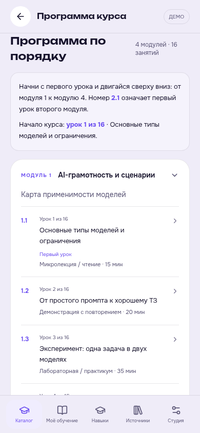
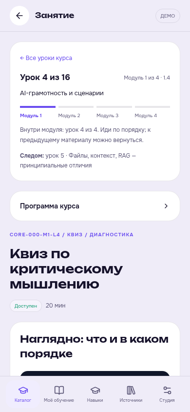
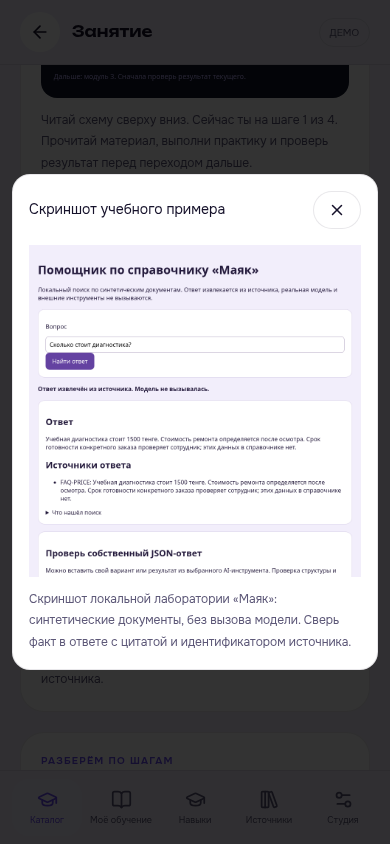

# Как проходить курс по порядку

Открой [список курсов](README.md), выбери программу и начни с ссылки **«Начать с урока 1»**. В мини-аппке открой курс и раздел **«Программа по порядку»**.

## Как читать номера

У каждого курса 4 модуля по 4 урока — всего 16 занятий. Урок **2.1** означает первый урок второго модуля; в общем списке это **урок 5 из 16**.

**1.1 → 1.2 → 1.3 → 1.4 → 2.1 → … → 4.4**

Внутри урока показаны его номер, текущий модуль и название следующего занятия. Внизу есть переходы **«Предыдущий»** и **«Следующий»** с названиями. После 1.4 переход ведёт к 2.1, а после 4.4 показано, что курс закончился и нужно проверить итоговую работу.

*Скриншот основной мини-аппки в локальном демо. Показывает порядок занятий; рабочая публикация материалов проверяется отдельно.*

*Скриншот локального демо: номер урока и модуль видны до материала. Число просмотров не заменяет зачёт.*

## Как пользоваться картинками

В каждом модуле есть схема с четырьмя настоящими названиями занятий. Читай её сверху вниз. В подходящих уроках добавлены скриншоты работающих учебных примеров: что получилось, как выглядит ошибка и где проверить результат. Подпись объясняет, на что смотреть и какие данные являются учебными.

В мини-аппке нажми **«Увеличить скриншот»**, чтобы рассмотреть детали. Закрой его крестиком или клавишей Esc. На GitHub картинку можно открыть отдельно.

*Просмотр изображения в локальном демо мини-аппки. Сам пример детерминированный, с вымышленными данными; внешний AI не вызывался.*

## Когда переходить дальше

1. Прочитай объяснение и сравни пример со схемой или скриншотом.
2. Выполни практику на своей разрешённой копии данных.
3. Сверь результат с критериями и выполни квиз или отправь работу, если они предусмотрены.
4. Переходи к следующему уроку. Чтобы вернуться к пропущенному, открой программу курса.

Переход по ссылке не отмечает урок завершённым. В мини-аппке сохраняются только результаты предусмотренной проверки. На GitHub материалы можно читать сразу; зачисление, зачёт и сохранение прогресса требуют публикации уроков в рабочую базу приложения.
