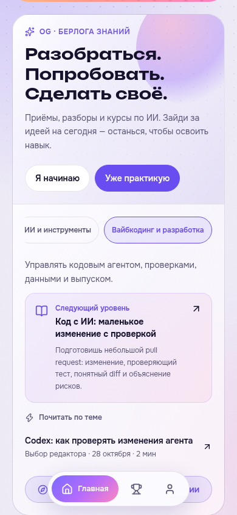

# Полный аудит OG CRE8R и улучшение базы знаний

28 октября 2026. Исходная версия: cc14551. Отдельные субагенты проверили безопасность, платежи, курсы, блог, геймификацию, сборку/выпуск, интерфейс и управление материалами. После аудита реализованы дополнительные запросы пользователя к админке и базе знаний. Проверки локальные; рабочие Telegram и Supabase не проверены. Скриншоты сняты в этом запуске с синтетическими данными.

## Реализовано

- Раздельная админка: Блог, Сторис, Материалы курсов. У каждого собственный список и настройки. Старые курсы и уроки вынесены в явно подписанный архив.
- Пагинация и поиск админки охватывают весь раздел, вместо первых500 смешанных записей. Требуется обновление Edge Function; клиент распознаёт старый сервер.
- На главной добавлена «Берлога знаний»:9тем, вход для начинающего и практикующего, тематические публикации и курс для следующего шага. Геймификация и нижнее меню сохранены.
- Все28курсов получили понятные описания аудитории, результата и маленького практического первого шага. Статьи связаны с курсами, курсы — с логичными продолжениями. Добавлены фильтры темы и уровня.
- «Мой следующий шаг» теперь предлагает настоящие курсы, а не блог с фиктивными XP/прогрессом.
- В публичные книги возвращены851 разрешённая ссылка на источники и32 ранее скрытых дополнительных примера первых курсов.
- Редакторские рекомендации не выдаются за живую статистику трендов. Новые новости о событиях не выдумывались.

## Незакрытые риски

| Приоритет | Проблема | Подробности |
|---|---|---|
| P1 | Два различных счёта могут привести к двум оплатам одного доступа без компенсации | [Платежи](payments.md) |
| P2 | Возврат покупки стирает последующую ручную выдачу; ошибки заявок и ограниченный список платежей | [Платежи](payments.md) |
| P2 | Анонимный setup перенастраивает фиксированные параметры бота; первая привязка канала не проверяет инициатора | [Безопасность](security.md) |
| P2 | Блог может вытеснить сторис из общего boot300; удаление игнорирует ошибку БД | [Блог](blog.md) |
| P2 | Рейтинг расходится при равных XP; ошибка выдачи достижения не восстанавливается повтором | [Геймификация](gamification.md) |
| P2 | При двух проверках урока UI показывает одну, сервер требует обе | [Курсы](courses.md), условный сценарий, в текущих448уроках не используется |
| P2 | Фокус под открытой статьёй, недостаточный контраст CTA, бонус недоступен клавиатурой | [Интерфейс](ui.md) |
| P2 | Нет обязательного CI-прогона серверных/SQL/content тестов перед выпуском | [Выпуск](build-release.md) |

P0 в проверенной области не подтверждены. Успешные тесты не означают отсутствия перечисленных дефектов: воспроизведения отдельно проверяют, что ошибка существует. Исходные отчёты могут описывать уже исправленный admin500/Journey/источники; актуальный статус приведён выше и в отчётах C1/C2/админки.

## Проверки выпуска

- Production build TypeScript/Vite прошёл.
- Academy200/200, API89/89, модели интерфейса7/7, знания5/5.
- Дополнительно субагенты проверили новости14, редакционные ревизии3, PostgreSQL/геймификацию, RLS24миграций:81таблица с RLS,114функций закрыты для anon/authenticated. npm audit production:0 известных уязвимостей.
- Браузерные сценарии:367публикаций без повторов;620публикаций админки без смешивания со сторис и уроками; раздельные настройки; чтение, перезагрузка, прогресс и переходы между уроками. Ширины320/390/1024, JavaScript-ошибок в успешных сценариях нет.
- [Админка](admin.md), [результат админки](admin/checks.json), [интерфейс](ui.md), [свежие экраны](ui/).

Отдельный сценарий `scripts/knowledge-browser.cjs` подтвердил выбор аудитории и темы, маршруты из реальных курсов, связи статей с обучением, оба примера CORE и доступность источников при недоступном API. [Результат](knowledge/checks.json).

## Выпуск

Публикация исходников в main не разворачивает Supabase. Для новых blog_feed и scoped admin_list требуется выпуск Edge Function api, SQL-миграция не нужна. В среде нет доступа для этой выкладки; рабочие endpoint/deployment не подтверждены. Реальные платежи, рассылки и изменения рабочей базы во время аудита не выполнялись.
