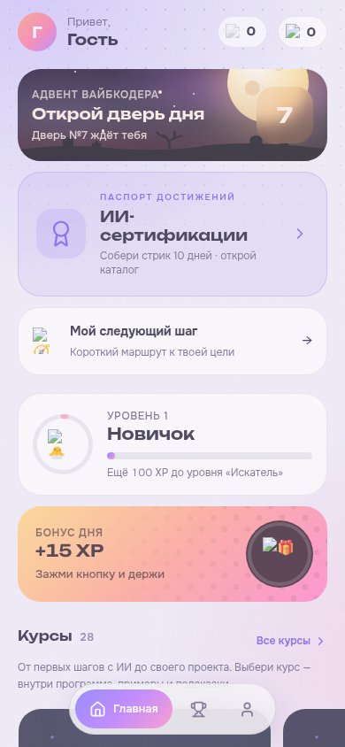
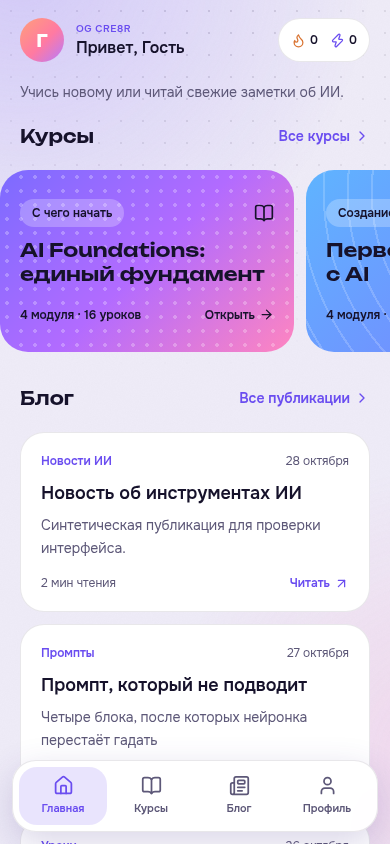
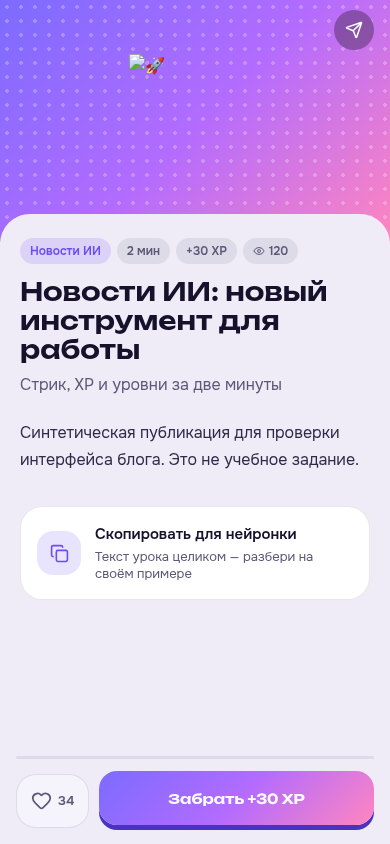
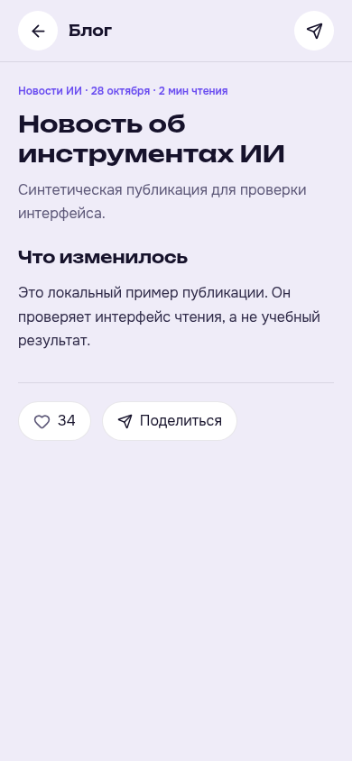
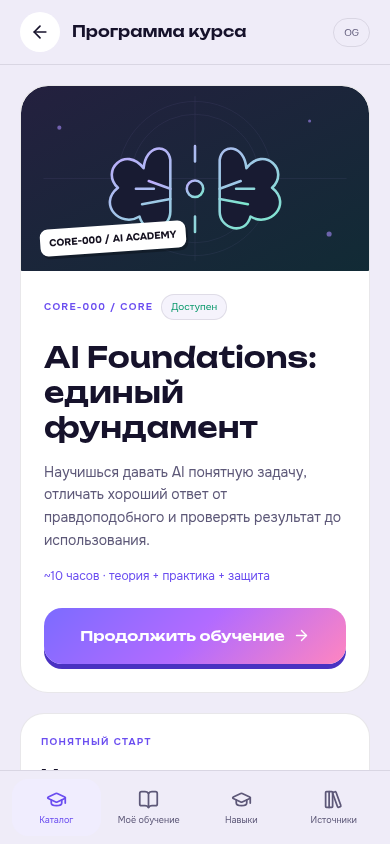
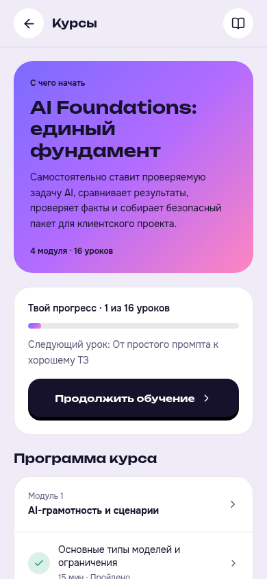

# OG CRE8R: главная, блог и курсы · 28 октября 2026

> Исторический отчёт. Вариант с четырьмя вкладками отклонён пользователем и заменён: [геймификация, рейтинг и полный материал](2026-10-28-gameplay-and-materials.md). Экраны ниже описывают предыдущую версию.

В предыдущей версии общий материал без курса открывался как урок с XP, а основные курсы использовали оболочку Академии. На главной перед содержимым стояли календарь, сертификаты, маршрут, уровень и бонус; подписи неактивных вкладок были скрыты.

Проверен путь **главная → блог → публикация** и **главная → курсы → программа → следующий урок**. Ниже — снимки текущего запуска до и после исправлений, локальная production-сборка с синтетическим API и учебными данными. Это **не снимки Telegram пользователя**: инструмент управления открытой встроенной вкладкой в этой сессии недоступен. Реальная проверка во встроенном браузере остаётся незавершённой.

## 1. Главная — исправлено

Курсы и блог видны сразу. Постоянное меню содержит четыре подписанные кнопки: «Главная», «Курсы», «Блог», «Профиль». На главной три карточки курсов; весь каталог из 28 программ открывается во вкладке «Курсы». Рейтинг, маршрут, бонус дня, сертификаты и отдельное демо доступны в профиле. Их данные не удалялись.

Сохранены цвета и карточки OG. Для текста на цветных карточках используется тёмный цвет; для главного действия курса — контрастная кнопка. Чтение публикаций больше не требует прокручивать блоки достижений.

| До | После |
| --- | --- |
|  |  |

## 2. Блог — исправлено

Публикации открываются отдельным читателем: категория, дата, время чтения, текст, реакции и отправка ссылки. У публикации нет квиза, учебного зачёта и получения XP. Даже если в старой записи были вопросы или значение XP, эти учебные элементы не появляются в блоге и не вызывают соответствующие API-действия.

Чтение поддерживает поиск, категории, фильтр непрочитанных, загрузку следующих публикаций и восстановление статьи по `#/blog/ID`. Локальные отметки чтения отделены от учебного прогресса и привязаны к пользователю. Ошибка лайка возвращает прежнее состояние и показывает понятное сообщение.

Старая схема хранит записи блога с `kind=lesson` и пустым `course_id`. Это имя хранения сохраняется для совместимости с API и очередью новостей. В интерфейсе такие записи классифицируются как публикации. Старые оплаты, учебные работы и результаты не переписываются.

Для автора путь теперь **профиль → админка → публикация**. В редакторе публикации нет настроек квиза и XP; у новой записи XP равен нулю. Редактор настоящих учебных материалов открывается через «Материалы курсов». Архив старых курсов подписан отдельно.

| До | После |
| --- | --- |
|  |  |

## 3. Курсы — исправлено

Основное обучение использует отдельные экраны OG: цветная карточка, одна кнопка начала/продолжения, прогресс и упорядоченный список модулей и уроков. Убраны обложка с надписью AI Academy и дополнительное меню «Каталог / Моё обучение / Навыки / Источники». Источники, подсказки и практические файлы остаются внутри уроков.

Платёж, запись, предварительная подготовка и проверка работ используют прежний защищённый API. Курс открывается только после подтверждения доступа сервером. Для опытного ученика сохранена отправка проекта на проверку подготовки. Если материал ещё не опубликован, интерфейс сообщает об этом и не выдаёт его за доступный урок.

Исправлено чтение прогресса: PostgreSQL возвращает `completed_at`, а локальный движок — явный флаг состояния. Оба подтверждённых формата распознаются. Проверено на настоящем результате SQL RPC: первый завершённый урок отмечается, продолжение ведёт ко второму. Просмотр страницы не становится завершением урока.

Академия остаётся отдельным локальным демо из четырёх занятий. Его прогресс и вопросы изолированы от основного обучения. Старый числовой каталог скрыт для учеников; административный архив, выданные доступы и история сохранены.

| До | После |
| --- | --- |
|  |  |

## Проверка и ограничения

Прошли сборка TypeScript/Vite и **301 автоматическая проверка**: Academy — 195, API — 83, новости — 14, интерфейсные модели и навигация — 6, редакционные ревизии — 3.

Четыре сценария Chromium:

- `scripts/og-clarity-browser.cjs`: четыре подписанные вкладки, блог без учебных запросов, повторное открытие статьи, поиск/непрочитанные, откат лайка, нативный каталог, прогресс SQL, переход ко второму уроку и редактор публикаций;
- `scripts/main-courses-browser.cjs`: каталог из 28 программ, скрытый архив, перезагрузка, изолированное демо без запросов к рабочему учебному API;
- `scripts/audit-fixes-browser.cjs`: восстановление пятой успешной попытки после сбоя, сохранность работы и откат лайка;
- `scripts/academy-study-browser.cjs`: чтение, практика, копирование команд, ZIP, увеличение иллюстраций и переход между модулями.

Проверены ширины 320/390/1024, кнопки основного меню не меньше 44 px, ошибок JavaScript нет. Полная проверка экранным диктором и соответствия WCAG не проводилась. Пропуски внешних эмодзи в старых снимках относятся к сетевым ограничениям локального запуска; доступность этих ресурсов в рабочем Telegram не подтверждена.

[Машинный результат основного сценария](og-clarity/checks.json). Внешние сообщения, реальные оплаты и публикация учебных пакетов в Supabase при проверке не выполнялись. Это изменение frontend и чтения формата прогресса; новой SQL-миграции для него нет.
