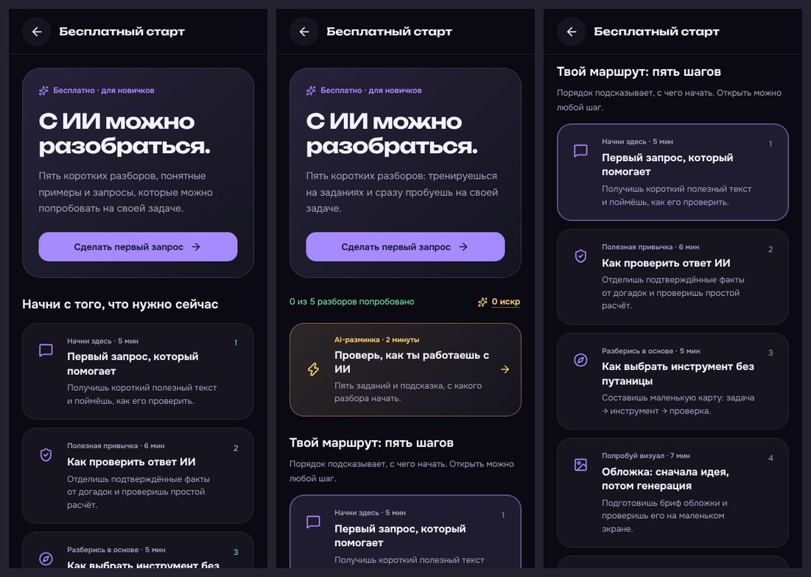
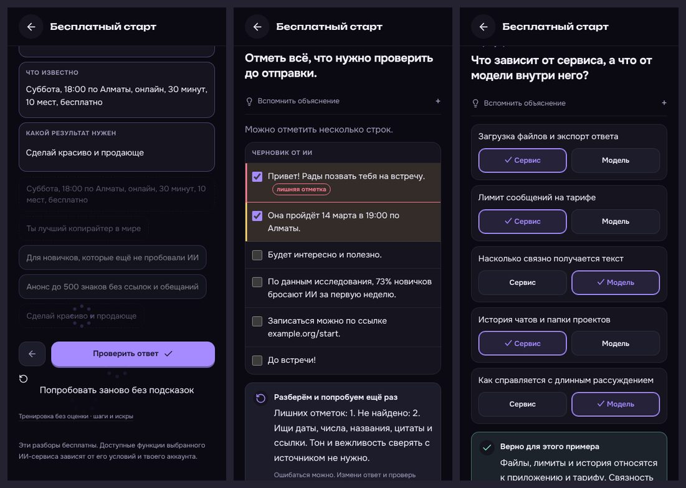
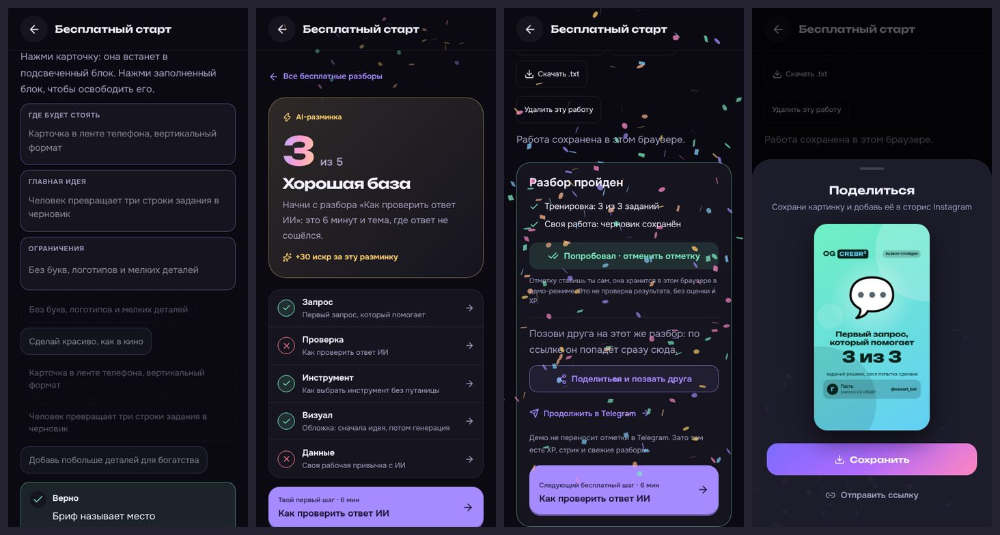
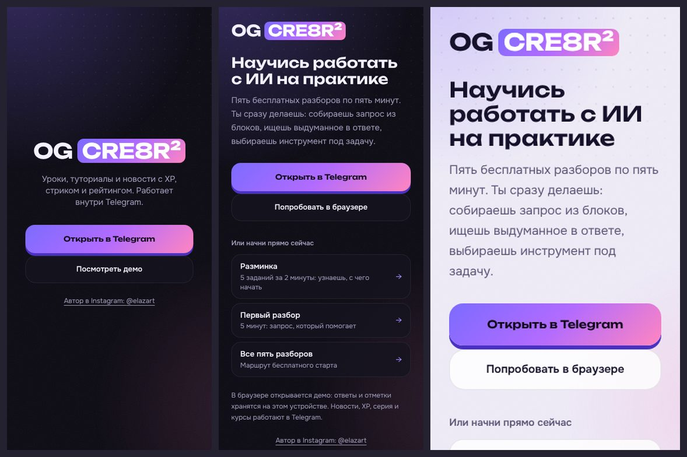
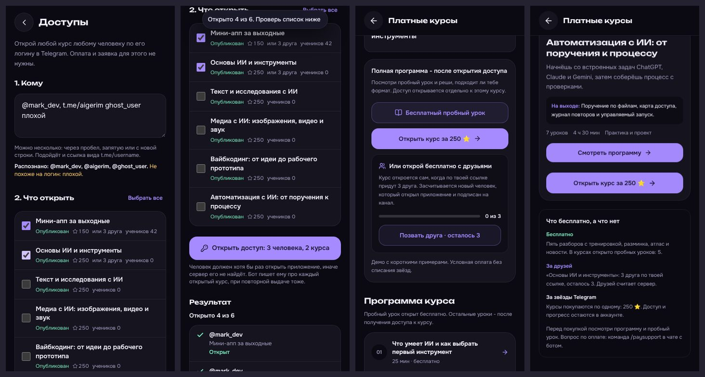
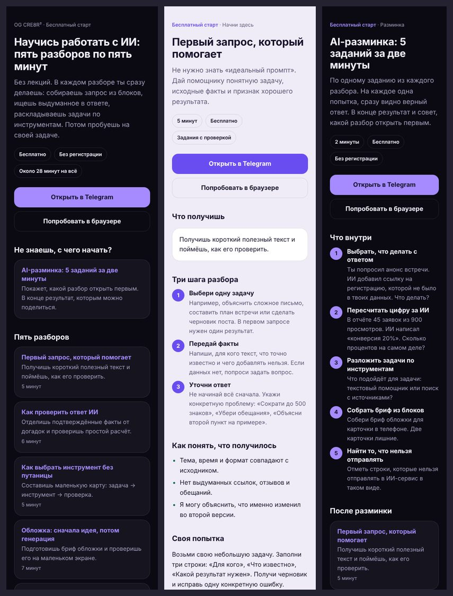
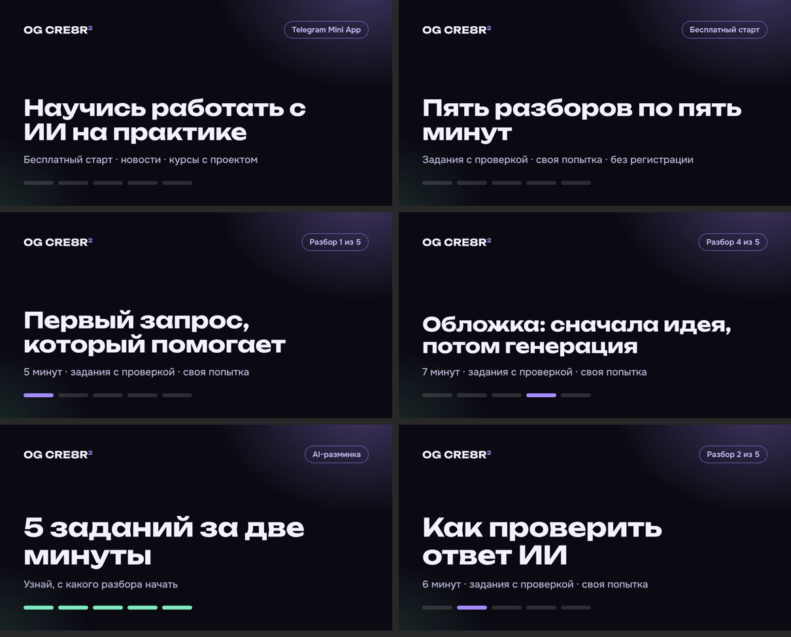

# Интерактивный бесплатный старт, рост и доступы: 27 и 28 ноября 2026

Ветка `feat/learning-growth-20261127` от main `579210f9c62aca0b4cc9a4624046235f5e8fa768`. Только интерфейс OG, статические страницы, скрипты сборки, тесты и документы. Edge API, миграции, база, цены и содержание платных уроков не менялись. Ветка не отправлена в GitHub и не выпущена: доступа на запись и к хостингу в этой сессии не было.

## Что изменилось для ученика

| Было | Стало |
| --- | --- |
| В разборе три формата заданий: выбор, число, порядок | Шесть форматов: добавлены «собери из блоков», «отметь фрагменты» и «разложи по группам». В каждом из пяти разборов одно новое задание |
| Список разборов без состояния | Маршрут из пяти шагов: видно, что попробовано, что начато и какой шаг следующий. Кнопка в шапке ведёт на следующий непройденный разбор |
| Разбор заканчивался отметкой | Итог разбора: что сделано, отметка «Я попробовал», кнопка «Поделиться и позвать друга» и крупный следующий шаг |
| Тренировка без отклика | Локальные искры и серия верных с первой попытки, короткое празднование. Слой отключается сборкой с `VITE_PRACTICE_SPARKS=off` |
| Нет быстрого входа | AI-разминка: пять заданий, по одному из каждого разбора, одна попытка, результат и совет, с чего начать |
| Карточки результата только для уровня, урока, серии и достижения | Карточки разбора и разминки. Ссылка на карточке ведёт друга сразу на тот же разбор или разминку и засчитывает приглашение |
| В каталоге только цена | Блок «Что бесплатно, а что нет» и открытие курса за друзей со счётчиком с сервера |
| В обычном браузере логотип и две кнопки | Экран с обещанием, двумя кнопками и тремя быстрыми входами |
| У ссылки на сайт нет превью | Описание, Open Graph и картинка 1200×630. Семь статических страниц: `/start`, пять разборов, `/start/warmup` |

## Что изменилось для администратора

- Экран «Доступы» в админке: логины в Telegram (можно несколько, подходят `@name`, `name` и ссылка `t.me/name`) и галочки курсов. Каждая пара отправляется существующей операцией `admin_grant`, результат показан так, как ответил сервер. Человека, которого сервер не знает, экран спрашивает один раз и остальные его курсы пропускает. Потеря прав останавливает всю пачку. Потерянный ответ считается ошибкой, а не успехом.
- В редакторе курса под ценой показана оценка: сколько платит покупатель и сколько получает автор. Цифры из `src/lib/stars-economy.ts`, это ориентир с датой проверки.
- Чего экран честно не умеет: забрать выданный доступ, показать список людей с доступом, открыть отдельный урок. Таких операций на сервере нет.

## Доступ за друзей, а не за репост

Курс за друзей использует серверное поле `invite_unlock`: сервер сам открывает курс при следующей загрузке, когда у человека набралось нужное число приглашённых. Приглашённый засчитывается, когда впервые открывает приложение по ссылке и подписан на канал. Интерфейс только показывает счётчик `me.invited` и даёт кнопку «Позвать друга».

Доступ за репост или лайк не сделан намеренно. Telegram не сообщает боту о репостах и лайках, проверить их нельзя.

Чтобы включить курс за друзей в production: админка, «Архив курсов и заявки», «Курсы», нужный курс, поле «Открыть за друзей». Рекомендация и расчёт в [документе об экономике](../UNIT-ECONOMICS-2026-11.md).

## Тексты и картинки

`scripts/copy-slop.mjs` ищет в русском тексте штампы машинного письма и длинные тире. Запуск: `npm run copy:check -- <файл или папка>`. Тест `test:copy` держит на нуле тексты бесплатного старта, каталога, экрана входа, экрана «Доступы», README и документ об экономике.

Что показал прогон по репозиторию 28 ноября:

| Область | Слов | Штампов | Длинных тире |
| --- | --- | --- | --- |
| `content/ai-practice-2026-10-25`, платные курсы и новости | 195 696 | 19, все в одном заголовке, слово стоит в кавычках как цитата чужого выражения | 1 609 |
| `content/elaz-ed-2026-10` | 89 506 | 0 | 787 |
| `content/ai-academy`, отдельная подсистема | 627 011 | 6, в отрицаниях | 3 754 |
| `src`, тексты интерфейса вне комментариев и вне копии мастера | | 0 | 22 в демо-данных адвента и одном демо-уроке: они собираются скриптом и выводятся через правило отображения. В остальном интерфейсе 0 |

Вывод: штампов в учебных текстах репозитория почти нет. Главная машинная примета это длинное тире. В теле уроков и в карточках ленты его уже убирает правило отображения `src/lib/plain-dashes.ts`. В этой ветке то же правило применено к заголовкам и подзаголовкам на экранах урока, статьи, сторис, главной и курсов. Исходники платных уроков не правились: они связаны с квитанцией импорта, а новости и уроки production лежат в базе, доступа к которой нет.

Картинки. В репозитории нет сгенерированных обложек: схемы уроков и новостей нарисованы кодом, в уроках настоящие снимки интерфейсов. Сгенерирован только персонаж Dots, его происхождение записано в `public/companion/provenance.json`. Обложки публикаций, загруженные через админку, хранятся в базе и здесь не проверялись. Новые картинки для превью ссылок нарисованы скриптом `scripts/og-covers.mjs` из названий разборов.

## Совместимость с развёрнутым сервером

- Ссылки-вызовы `g_<разбор>_r<id>` и `g_warmup_r<id>`: сервер уже разбирает приглашение по `_r<id>`, приложение разбирает `g_<разбор>` и `g_warmup`.
- Новые виды карточек `guide` и `warmup` при загрузке картинки уходят на сервер как `level`: сервер и так приводит неизвестный вид к этому значению. Кнопка «Отправить в чат» для них скрыта, потому что серверный текст сообщения описывал бы другой результат.
- Разминка не отправляет событий разборов: её идентификатора нет в серверном списке допустимых.
- Экран «Доступы» использует только `admin_courses` и `admin_grant`.
- Версия содержания бесплатных разборов поднята до `free-guides-v2`.

## Проверки

Локально, Node 24.22.3, Linux:

- `npm run test:all` на коммите с кодом этой ветки: 54 этапа из 54, 47 наборов тестов и 7 этапов сборки, 1 037 тестов, 0 падений. До изменений на main было 50 из 50.
- Новые наборы: `test:access` 14 тестов, `test:copy` 5, `test:growth` 23, `tests/practice-sparks.test.mjs` в составе `test:guide-interactions`.
- Chromium, ширина 320 и 390, тёмная и светлая тема: бесплатный старт, все шесть форматов заданий, разминка, итог разбора, карточка, каталог с уровнями, курс за друзей, экран «Доступы», экран входа, статические страницы. Горизонтальной прокрутки и ошибок в консоли нет.
- Только клавиатура: разминка целиком, все пять её форматов, Tab, пробел, Enter и ввод числа. Фокус виден.
- `prefers-reduced-motion`: основной сценарий разбора и разминки проходит, движения празднования нет.
- Сборка с `VITE_PRACTICE_SPARKS=off`: счётчика искр, строки начисления и конфетти нет, слово «искры» не встречается.
- Сценарий `scripts/og-product-browser.mjs` воспроизведён на локальной production-сборке: 320 и 390, обе темы, черновик атласа переживает перезагрузку, вкладка новостей открывается.
- Статические страницы открыты с выключенным JavaScript.

## NOT VERIFIED

- Настоящий клиент Telegram на iOS и Android: кнопка «Назад», вибрация, звук, отправка карточки в сторис.
- Production-сервер: начисление приглашения по новой ссылке, открытие курса при `invite_unlock`, ответ бота на `/start g_warmup`. Логика прочитана в коде, запросы не выполнялись.
- Оплата звёздами и возвраты: код оплаты не менялся, проверка в production не проводилась.
- Vercel: правила `/start` в `vercel.json` и абсолютные адреса картинок, которые сборка подставляет из `VERCEL_PROJECT_PRODUCTION_URL`. Локальный предпросмотр эти правила не исполняет.
- Как превью показывают Telegram, WhatsApp и другие мессенджеры: теги проверены тестом, сами сервисы нет.
- Задание `verify` в GitHub Actions на Windows: в этой среде установлен браузер другой версии Playwright, поэтому сценарий запускался другим экземпляром той же библиотеки.
- Экран «Доступы» с настоящим сервером: проверен на демо-данных и тестами на ответы `user_not_found`, `not_found`, `forbidden` и обрыв сети.
- Цифры юнит-экономики: это модель на допущениях, данных о продажах нет.

## Решения, которые ждут владельца

1. Геймификация тренировок. Заменяет правило «без звуков и confetti в тренажёре». Если решение не принято, сборка с `VITE_PRACTICE_SPARKS=off` возвращает прежнее поведение без отката кода.
2. Цены и курс за друзей. Меняются в админке, код менять не нужно.
3. Серверные доработки, которых нет: отзыв доступа, список людей с доступом, доступ к отдельному уроку, набор курсов одной покупкой.
